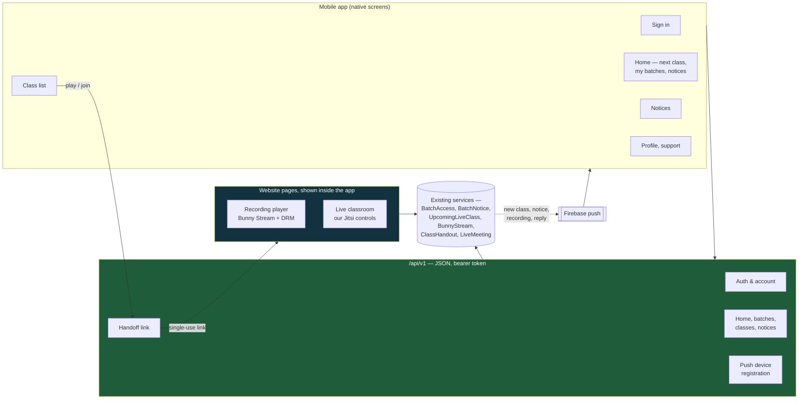
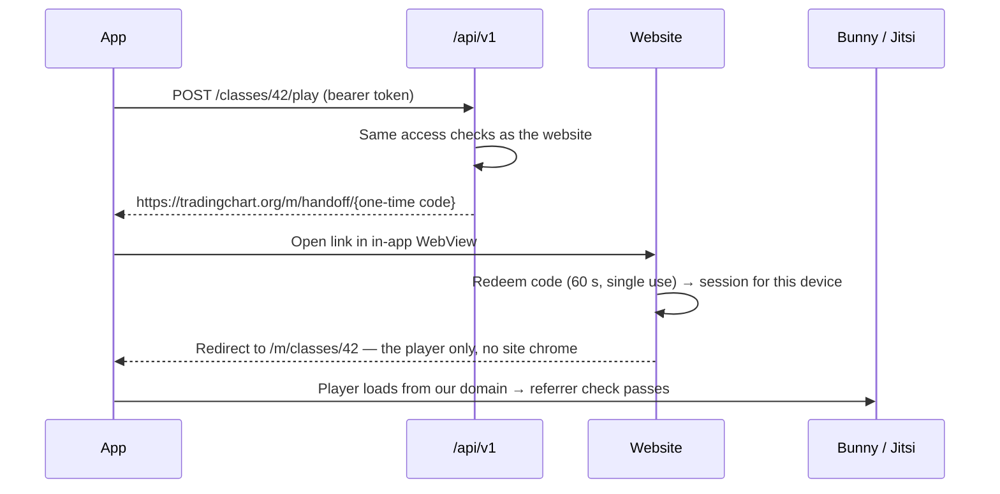
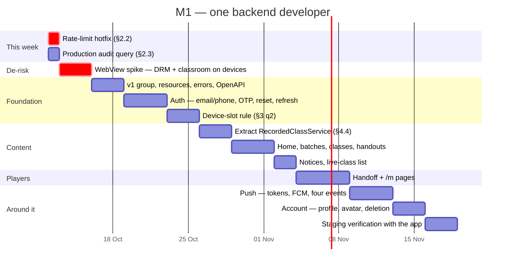

# M1 — The Mobile API (`/api/v1`)

**Series:** Mobile — the first document. The student-UX series ([parent plan](STUDENT_UX_ENHANCEMENT_PLAN.md)) deliberately left the app out of scope; this is where it comes back in.
**Scope:** The backend the new student app talks to. The app itself lives in its own repository, `trading-chart-mobile` (bare React Native 0.87, app ID `org.tradingchart.app`).
**Date:** 8 October 2026
**Status:** Build plan — **§2.2 is a hotfix to ship this week; §3 questions 1 and 2 need a decision before the build starts**
**Audience:** Founders and product for §1–§3, engineering for §4 onward
**Blocks:** every screen in the mobile app beyond the login form

---

## 1. What we are building

A student who has bought a batch should be able to open an app on their phone and do the
four things they come to the website for: **see what's next, watch the recordings, read
the handouts and notices, and join the live class.** Push notifications tell them when
any of those changes.

The app has been restarted from scratch in its own repository. The old `mobile-app/`
folder in the application repository was a generic course-shop template from January
that was never connected to our backend. Nearly every address it called does not exist,
and it has no idea what a batch is.

**The app is the easy half. The blocker is that nearly everything a batch student uses
exists only as website pages, not as an API the app can call.** This document plans that
API: what it serves, how it decides who sees what, and how the two hardest screens (the
video player and the live classroom) get onto a phone without rebuilding them.

> **v1 sells nothing.** Apple and Google generally require their own in-app billing, at
> 15–30%, for digital course content, and selling through SSLCommerz inside the app is a
> common reason for store rejection. Enrolment and payment stay on the website. See
> §3 question 1.

---

## 2. What the code review found

### 2.1 🔴 The API we have is not the API the app needs

There is an `/api` today, and the project notes say the web frontend and the React Native app
both use it. For anything batch-related that is no longer true. It was written for the
earlier course → module → lesson model, and the product has since moved to batches,
recorded classes, notices and a self-hosted classroom, all built as website pages.

| What a student does | On the website | In `/api` today |
|---|---|---|
| Sign in | Email **or phone** + password, Google, Facebook | Email + password only (§2.4) |
| See their batches and next class | Dashboard tiles, countdown pill | ❌ — `/api/dashboard` counts enrollments and reads lesson progress, which batch courses do not have |
| List recorded classes | Class list on the learn page | ❌ — `/api/enrollments/{id}/lessons` lists module lessons; batch courses have none |
| Play a recording | Signed Bunny Stream embed | ❌ — the token route is website-only (session login) |
| Download a handout | Access-checked PDF stream | ❌ — website-only |
| Read batch notices | Notice board + read receipts | ❌ |
| Join a live class | Classroom page with our Jitsi controls | ⚠️ — `/api/live-classes/{id}/join` writes an attendance row and returns no room, so there is nothing to join |
| Get told something changed | Realtime toasts while the site is open | ❌ — no push notifications at all |
| Support tickets | Support portal | ✅ — `/api/tickets` is usable as-is |

**So the app is not "a new frontend on an existing API". About 80% of the API it needs
has to be written.** The good news is that almost none of the *logic* does: every row
marked ❌ already has a service behind the website page (`BatchAccessService`,
`BatchNoticeService`, `UpcomingLiveClassService`, `BunnyStreamService`,
`ClassHandoutService`). The work is putting a JSON door on rules that already exist,
without copying them.

> **Technical note.** The web frontend's own `/api` usage is close to nil — `utils/api.js`
> has `baseURL: '/api'`, but the only call found in `resources/js` is
> `/api/youtube/subscribers`. That is why §4.1 builds `/api/v1` beside the legacy routes
> rather than rewriting them in place. Nothing in the field depends on the legacy shape,
> but there is no reason to break it either.

### 2.2 🔴 No API route is rate-limited, including the password login

`routes/api.php` defines an `api` rate limiter (60 a minute) at the bottom of the file,
but **nothing ever attaches it.** The `api` middleware group contains only route binding
and the single-device check. As a result `POST /api/auth/login` accepts unlimited password
guesses, and so do registration and OTP resend (each of which sends an email).

The OTP *verify* route is safe: it counts attempts per user in the cache and locks after
the limit. Password login has no such counter.

**Recommendation: hotfix this week, ahead of everything else in this plan.** Attaching
the existing limiter to the group is a one-line change. Tighter per-route limits on login,
register and OTP resend go in at the same time.

> **Technical note.** Verified by printing the router's `api` group at runtime:
> `SubstituteBindings`, `EnsureSingleDeviceSession`, nothing else. Laravel 11+ does not add
> `throttle:api` by default. It needs `$middleware->throttleApi()` in `bootstrap/app.php`,
> or an explicit `throttle:` on the routes. Suggested: `throttle:5,1` keyed by email + IP
> on login, `throttle:3,10` on register and resend-otp.

### 2.3 🔴 Fixed on 8 October: the API could enrol anyone in a paid course for free

This is recorded for completeness; the fix is on branch `fix/mobile-api` (commit
`2ea59ac`). Two leftover demo endpoints were live in production:

- `POST /api/checkout` with `payment_method: bank_transfer` marked the payment completed
  and created **active, paid enrolments**, with no gateway and no admin.
- `POST /api/payments/webhook` was public and checked no Stripe signature. A forged
  "payment succeeded" event completed any pending payment.

We do not use Stripe, and nothing called either endpoint. Both are removed, and a test now
attempts both attacks and checks they fail.

**One action is still open:** check production for anyone who already used them:

```sql
SELECT * FROM payments
WHERE transaction_id LIKE 'BT-%' OR stripe_payment_intent_id IS NOT NULL;
```

Any row there is an enrolment nobody paid for.

### 2.4 🟠 App sign-in only works for some of our students

The website accepts **email or phone** with a password, plus Google and Facebook. The
API accepts **email only.** In practice:

| Student | Can they sign in to the app today? |
|---|---|
| Registered by email | ✅ |
| Registered by **phone only** (no email on the account) | ❌ — the API asks for an email they do not have |
| Bought through quick checkout | ✅ by email, but only if they kept the temporary password from the welcome mail |
| Signed up with Google or Facebook | ❌ — their account holds a random password they have never seen |

There are smaller differences too. The website lets an admin switch email verification
off (`require_email_verification`), and the API ignores that switch. The website accepts a
phone-verified account with no email, and the API has no notion of phone verification.

**Recommendation:** v1 sign-in matches the website's password form exactly: email *or*
phone, with password reset by email or SMS code. Students who only ever used Google get a
clear "set a password on the website" path (or Google sign-in later, §3 q4). The rules for
verification and suspension come from **one** place shared by web and API, so they cannot
drift apart again.

### 2.5 🟠 The phone and the laptop share one login slot

The single-device rule (built in August against account sharing) gives each student
**one** login across the whole platform, and the app shares it with the website. Its own
code says so: *"signing in on the app ends a live class someone left running in a
browser."*

That was a sound rule when the app did not exist. Once it does, it means a student who
watches recordings on their phone on the bus is **signed out of the website every time,
and the other way round.** Expect that to become the app's most common complaint.

This is a business decision, not a bug. The options are in §3 question 2.

> **Technical note.** `user_devices` has a unique `user_id`: one row per user, holding
> either a web session or an API token (`guard`). A "one browser + one phone" rule means
> unique on `(user_id, guard)` and splitting `DeviceSessionService::revokePrevious()` so a
> web login only evicts the web row. `PreventConcurrentLiveSession` blocks a *different*
> class only, so under that rule the "one screen per live class" guarantee needs a
> same-class check added there. That is where account sharing actually costs money.

### 2.6 🟠 The two players cannot simply be rebuilt as native screens

The recording player and the live classroom are the two screens that matter most, and
both carry protections that live in the website:

- **Recordings** play from Bunny Stream with signed, expiring links and DRM, and the Bunny
  library is set to **only play on our own domain** (Allowed Referrers). A native player,
  or an embed loaded straight into the app, does not come from our domain, so the video
  refuses to play. Turning the referrer check off would reopen the leak that the August
  move to Bunny Stream closed.
- **The live classroom** is our customised Jitsi page. Mic lock, screen-share grants,
  follow-me, the recorder-only rules for several moderators, the End Session flow: all of
  it lives in the website's classroom code. Rebuilding it with the native Jitsi SDK means
  redoing and re-testing all of that classroom work, for a second client that would then
  have to be kept in step forever.

**Recommendation: native screens for everything a student browses, and the website's own
player and classroom pages shown inside the app for those two screens.** The app gets
a single-use link that signs it into the website for that one page. The page is served
from our domain, so Bunny's referrer check passes unchanged, and every classroom rule
already in place still applies. §4.3 has the mechanism; §3 question 5 asks for approval.

### 2.7 🟠 "Who may see batch content" still has more than one answer

[P2-A §2.2](P2A_MY_BATCH_PAGE_PLAN.md) found the website giving three different answers
to which enrollments grant access. The dashboard tiles and live classes accept `active`
and `completed`; recorded video still accepts **any** status, so a refunded student can
keep streaming. Whether a refund should revoke video access was never decided.

The app is a new surface and has to pick an answer. **It must call the same services the
website calls, not re-implement the query.** The live-class batch leak in August existed
twice precisely because the access query had been copy-pasted. §3 question 3 asks for the
refund answer so both surfaces can apply it together.

### 2.8 🟡 Responses are raw database rows

Most current endpoints return models directly: `'user' => $user`, whole `Payment` rows
with their relations. That works, but the app then depends on our column names and
breaks if one is renamed, and every new column is shipped to the phone whether or not
it should be. v1 defines each response shape explicitly (Laravel API Resources), and
those shapes are the contract with the app.

### 2.9 🟡 App tokens never expire

`config/sanctum.php` sets `expiration => null`. The single-device rule limits the damage
(a new login deletes the old token), but a token copied off a phone works until that
student next signs in somewhere else. v1 gives tokens a lifetime (suggested 60 days, renewed
silently while the app is in use) and a sign-out that really revokes.

### 2.10 🟡 Two store requirements land on the backend

- **Account deletion from inside the app.** Apple requires an app that creates accounts
  to let users delete them in the app. `UserDeletionService` exists but only admins can
  run it. v1 adds a self-service request. Recommended form: the student confirms, the
  account is deactivated at once and deleted after a short grace period, so a mis-tap is
  recoverable. Paid enrolments and invoices follow the same rules the admin delete uses.
- **Sign in with Apple** becomes mandatory on iOS the moment the app offers Google sign-in.
  This is the main reason §3 question 4 recommends leaving Google out of v1.

---

## 3. Questions for the business

| # | Question | Recommendation |
|---|---|---|
| **1** | Does the app sell courses? | **No — v1 is a companion app for enrolled students.** Non-enrolled users see "enrol on the website" with no in-app checkout. Store rules on linking out to a web checkout vary by region and change often; a plain message is the safe default |
| **2** | How many devices may one student use? | **One browser + one phone**, but **only one screen inside a live class at a time.** Recordings on the phone while signed in on the laptop is normal use; two people in the same live class on one account is the sharing we actually lose money on (§2.5) |
| **3** | Does a refund revoke access to recordings? | **Yes** — use the same `active` + `completed` rule live classes already use, on web and app together (§2.7) |
| **4** | Google sign-in in v1? | **Not in v1.** On iOS it forces Sign in with Apple as well. Ship password + SMS/email code first, add Google (and Apple) as a follow-up |
| **5** | Approve the hybrid players (§2.6)? | **Yes** — native browsing, website player and classroom inside the app. It is the difference between weeks and months, and between one classroom and two |

Questions 1 and 2 shape the build. The rest can be answered while it runs.

---

## 4. The build

### 4.1 Shape



Three rules hold the whole thing together:

1. **`/api/v1` is new and separate.** Legacy `/api` routes stay as they are (rate-limited
   per §2.2) and are retired once the app ships and nothing calls them.
2. **No access rule is written twice.** Every v1 endpoint goes through the service the
   website page uses. Where a website controller holds the logic inline, it is moved into
   a service first and the website switches to it as well.
3. **Every response has a declared shape** (§2.8), and an OpenAPI description of v1 is
   kept in the repository for the app developer to work from.

### 4.2 The endpoints

| Group | Endpoint | Built from |
|---|---|---|
| **Auth** | `POST /auth/login` — email *or* phone + password | Website `LoginController` rules, moved to a shared service (§2.4) |
| | `POST /auth/register`, `/auth/verify-otp`, `/auth/resend-otp` | Existing API `AuthController`, corrected for phone-only accounts |
| | `POST /auth/password/forgot`, `/auth/password/reset` — by email or SMS code | Website `PasswordResetController` OTP flow |
| | `POST /auth/logout`, `POST /auth/refresh` | New (§2.9) |
| **Account** | `GET /me`, `PATCH /me`, `POST /me/password`, `POST /me/avatar` | Existing API + `AvatarStorage` |
| | `POST /me/delete-request` | `UserDeletionService` behind a grace period (§2.10) |
| **Home** | `GET /home` — next live class with countdown, my batches, unread notice count | `UpcomingLiveClassService`, `BatchActionService`, `BatchNoticeService` |
| **Batches** | `GET /batches` — every batch the student holds | `BatchAccessService::allAccessibleBatchIds()` |
| | `GET /batches/{id}` — course, dates, instructor, routine, Telegram link | `BatchActionService` |
| | `GET /batches/{id}/classes` — the recorded class list, welcome clip first | Learn page's batch branch, extracted (§4.4) |
| **Classes** | `GET /classes/{id}` — one class: title, duration, handouts | Same extracted service |
| | `POST /classes/{id}/play` → single-use player link | Handoff (§4.3) |
| | `GET /classes/{id}/handouts/{pdf}` — the PDF itself, streamed | `ClassHandoutService::readStream()` with the website's checks |
| **Live classes** | `GET /live-classes`, `GET /live-classes/{id}` | `LiveClass::visibleTo()` / `isAccessibleBy()` |
| | `POST /live-classes/{id}/enter` → single-use classroom link, or the external URL for Zoom/Meet classes | Handoff (§4.3), `LiveMeeting` driver |
| **Notices** | `GET /notices`, `POST /notices/read` | `BatchNoticeService::forStudent()` / `markRead()` |
| **Push** | `POST /devices/push-token`, `DELETE /devices/push-token` | New (§4.5) |
| **Support** | `/tickets/*` | Existing API, re-mounted under v1 with resources |

Not in v1: cart, checkout, payments, reviews, the AI chat widget. See §7.

### 4.3 The handoff: website pages inside the app

The app holds a bearer token, and the player and classroom pages expect a website login.
The handoff bridges the two for exactly one page:



What makes it safe:

- **The code is single-use and short-lived** (60 seconds), bound to the user, the device,
  and the one page it was minted for. A copied link is useless.
- **The access check runs twice**, once when the code is minted and again on the page,
  through the same middleware the website uses (`session.enrolled`, `session.is.live`,
  and so on).
- **The WebView signs in as the phone, not as a new device.** If it claimed a slot of
  its own, opening a recording would sign the app out (§2.5).

> **Technical note.** Pages under `/m/*` are thin Inertia layouts that reuse the existing
> components: the Bunny player from the class page, and `LiveClasses/Room` with
> `JaasEmbed.jsx`, minus the site header and footer. The redeem route calls a new
> `DeviceSessionService::adoptForHandoff()` that writes the session against the **API
> device's** `device_id`, so `EnsureSingleDeviceSession` sees the same device. Codes live
> in the cache, not a table.
>
> WebView requirements to verify in the spike (§5): Android must grant
> `RESOURCE_PROTECTED_MEDIA_ID` for DRM playback and camera/microphone for the classroom
> (students are mic-locked but instructors may grant the mic). Jitsi needs
> `disableDeepLinking: true` so it does not redirect phone browsers to the Jitsi Meet
> app. Media must be allowed to autoplay inline. iOS WKWebView supports WebRTC since
> 14.3; FairPlay DRM inside WKWebView is the one item that must be proven on a device.

### 4.4 One class list, two doors

The learn page's batch branch builds the class list inline in a ~400-line controller
method (`CourseController::learn`), with the shape in `recordedClassPayload()`. v1 needs
exactly that list. **It is moved into a `RecordedClassService` first, and the learn page
switches to it**, so web and app cannot show different classes or different handouts.
The web URLs inside the payload (handout links) become per-caller: website routes for
the website, v1 routes for the app.

### 4.5 Push notifications

| Event | Who is told | Source |
|---|---|---|
| Live class starts in 15 minutes / is live now | Students of that batch | Scheduler + `LiveClass::visibleTo()` |
| New recording published | Students of that batch | `BatchVideo` published |
| New notice | Students of that batch | `BatchNotice` created |
| Support replied | That student | Where `SupportReplyReceived` already fires |

> **Technical note.** Push tokens go in a **new `push_tokens` table**, not on
> `user_devices`. That row is replaced whenever the student signs in somewhere else, and
> push must survive a web login. Sending is via Firebase Cloud Messaging (HTTP v1) on its
> own queue, so it never shares a lane with mail (see the mail-throttle work). Dead tokens
> reported by FCM are deleted on the spot. Each event is a Laravel notification with a
> `database` channel as well as push, which leaves the door open for P3-B's notification
> centre to read the same rows.

### 4.6 Conventions

- **Errors** always come back as `{ message, errors? }` with the right status code. The
  app never has to read an HTML error page.
- **Pagination** is cursor-based on lists that grow (notices, live classes).
- **Rate limits** follow §2.2 on every v1 route, with tighter limits on auth.
- **Dates** are ISO 8601 with time zone. The app formats them; the server never sends
  "3 minutes ago".
- **Language:** responses carry text in the student's chosen language (`Accept-Language`,
  falling back to the profile), through the existing `TranslationService`.

---

## 5. Sequencing

The two items most likely to change the design go first: the rate-limit hotfix, because
it is a live exposure, and a WebView spike, because if DRM or the classroom will not run
inside a WebView, §4.3 changes.



**About 38 working days for one backend developer — just under eight weeks.** This series
has learned that estimates grow once the code is read, and this one was written after
reading it, but the spike can still move it.

The app does not have to wait for the end. Once the foundation is in (about three weeks
in), a mobile developer can build sign-in, home and the class list against staging while
the backend continues with the players and push.

---

## 6. How we will know it worked

| Check | Where | Passes when |
|---|---|---|
| No guessing passwords | Feature test | The sixth login attempt in a minute gets `429` |
| Every student can sign in | Feature test | Email, phone-only and quick-checkout accounts all receive a token; suspended accounts never do |
| One rule for access | Feature test | For every v1 content endpoint, a student of batch A gets `403` on batch B's class, handout, notice and live class, the same as on the website |
| Refunds | Feature test | After the §3 q3 decision, a refunded enrollment loses web and app access together |
| Web and app agree | Feature test | `GET /batches/{id}/classes` and the learn page list the same classes, in the same order, with the same handouts |
| Handoff cannot be replayed | Feature test | A redeemed code, an expired code, and a code minted for another user all fail |
| The handoff does not sign the app out | Feature test | After a handoff, the app's token still works |
| Recordings play on phones | Manual, real devices | A DRM recording plays in the app on a low-end Android and an iPhone, and the same embed URL fails in a desktop browser |
| The classroom works | Manual, real devices | A student joins from the app, stays mic-locked, receives a mic grant, follows the presenter, and leaves cleanly |
| Push arrives | Manual | All four events arrive with the app closed |
| No response leaks a stored file URL | Feature test | No v1 response contains a Bunny storage URL, `pdf_url` or `source_url` for a protected source |

---

## 7. What M1 does not include

- **No buying in the app** (§3 q1): no cart, checkout, payments or coupons.
- **No Google, Facebook or Apple sign-in** in v1 (§3 q4).
- **No native video player and no native Jitsi SDK.** Both players are the website's (§2.6).
- **No offline downloads of recordings.** DRM and signed links make this a separate project.
- **No AI chat in the app.** The website widget stays on the website; it can follow later on the same handoff.
- **No instructor or admin features.** The app is for students.
- **No rewrite of the legacy `/api`.** It is rate-limited and left alone, then retired.
- **No notification centre screen.** Push events are stored so [P3-B](P3B_NOTIFICATION_CENTRE_PLAN.md) can build one on them.

---

## 8. Risks

| Risk | Likelihood | Handling |
|---|---|---|
| DRM recordings will not play inside a WebView on some phones | **Medium** | The spike comes before any other build work. Fallback is Bunny's non-DRM token-only mode for app playback, which keeps the signed, expiring link |
| The classroom is heavy on low-end Android phones | Medium | Students receive video and are mic-locked, which is the light case. Test on the cheapest phone students actually use, not a developer's flagship |
| Store review rejects the app as "just a website" | Medium | Browsing, home, notices and push are native; only the two players are web. Give reviewers a demo account in a demo batch — the `is_demo` live class work makes this safe |
| Changing the device rule weakens account-sharing protection | Medium | §3 q2's recommendation keeps the live-class rule strict, and that rule is where sharing costs money |
| Web and app drift apart again | Medium | §4.4 — one service, both doors, and a test that compares them |
| Push tokens pile up or go stale | Low | Deleted when FCM reports them dead, and on sign-out |
| The handoff becomes a way in | Low | Single use, 60 seconds, user + device + page bound, access re-checked on the page |

---

## 9. Recommended decision

**Ship §2.2 this week, then proceed with the build.**

The rate limit is a one-line fix for a live exposure and should not wait for the rest. The
production audit in §2.3 is a single query and should run at the same time.

For the build itself, two decisions shape it and should be made before it starts: **the
app sells nothing in v1** (§3 q1), and **how many devices a student may use** (§3 q2). The
hybrid player approach (§3 q5) is the engineering recommendation that keeps the project at
two months rather than six. The spike at the front of the schedule exists to prove it, or
to change it early and cheaply.

---

*Series: M1 (this document). The app's own build plan, covering screens, navigation and
releases, will follow as M2 once §3 is answered.*
