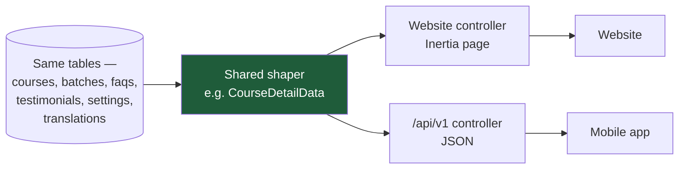
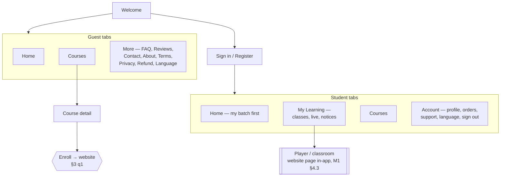
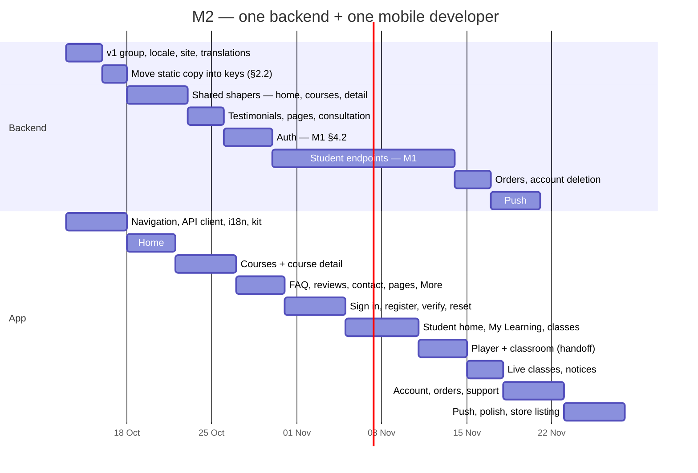

# M2 — The Mobile App, Page by Page

**Series:** Mobile — [M1 — The Mobile API](M1_MOBILE_API_V1_PLAN.md) · M2 (this document)
**Scope:** Every screen in the student app, the website page it mirrors, and the API endpoint that feeds it. The app lives in `trading-chart-mobile` (React Native 0.87, `org.tradingchart.app`).
**Date:** 8 October 2026
**Status:** Build plan — **§3 question 1 decides how far the course pages go; the rest can be answered during the build**
**Audience:** Founders and product for §1–§3, engineering for §4 onward
**Depends on:** M1 for everything behind sign-in. The public pages in §4.2 do not.

---

## 1. What we are building

A complete Trading Chart app, not just a companion for enrolled students. A visitor can
browse the same home page, courses and information pages as the website. A student signs
in and finds their batch, classes, live sessions, notices, orders and support in one
place.

**The governing rule: the app shows the website's content, not copies of it.** Every
headline, course description, FAQ, testimonial and price an admin edits today
(in Admin → Translations, Courses, FAQs, Testimonials, Settings) must appear in the app
with no second place to edit it. In practice:

- **Text comes from the same translation keys** the website reads (`page.welcome.*`,
  `course.{id}.*`, `button.*` and so on), in English or Bengali.
- **Lists come from the same tables:** courses, batches, fun facts, testimonials, FAQs,
  social links, trading accounts.
- **The shaping is shared.** Each website page already turns those rows into exactly the
  shape its screen needs: translated title, price in the right currency, seats left,
  next batch. That shaping moves into one PHP class per page, and the website controller
  and the API endpoint both call it. They cannot drift apart because there is only one of
  each.

Built screen by screen, starting from the welcome screen that already exists, against the
local backend on port 8000.

---

## 2. What the code review found

### 2.1 🔴 The public API returns raw database rows, not what the website shows

The API already has public course, FAQ and review endpoints, so it is tempting to
build the course screens on them. They would show different content from the website:

| Data | What the website page receives | What `/api` returns today |
|---|---|---|
| Course list | Translated title and subtitle, price in the visitor's currency, seats left, rating, level, card button text | Raw `courses` rows: English only, base price, no seats, no rating |
| Course detail | All of the above, plus instructor stats, curriculum, default batch, enrollment window, pending payment, reviews | The model with `instructor` and `modules.lessons` attached; no batch, no translation |
| Reviews page | **Testimonials** (the curated quotes) with star statistics | `/api/reviews` reads **course reviews**, a different table |
| FAQs | Translated, top 10 on home, all on `/faq` | Translated ✅, grouped by category |
| Home page | Eight sections of content (§4.2.2) | ❌ No endpoint at all |
| Contact details, footer, social links | Shared with every page | ❌ No endpoint |
| About / Terms / Privacy / Refund | CMS pages | ❌ No endpoint |
| Translations, languages | Shared with every page | ❌ No endpoint |

**So the existing public endpoints are not reused as they are.** Each screen gets a `/api/v1`
endpoint that calls the same shaping code as the website page (§4.1). FAQs are the only
endpoint already close to right.

### 2.2 🟠 Some website copy is not in the database at all

Three pieces of marketing copy live in the website's JavaScript, not in Admin:

| Copy | Where it lives today |
|---|---|
| Course page instructor card: badge, four stats ("10k+ Students", "5 Years Real Market Experience"…), cut-out photo | `Pages/Courses/Show/showStaticContent.js` |
| Course highlights ("Live Chart Analysis", "Lifetime Learning Support"…) | Same file |
| Home "Build a Successful Trading Career" quotes | Hard-coded array in `Pages/Welcome.jsx` (the text itself is translation keys) |
| The trading-accounts video link | Hard-coded in `HomeController` |

An app that copied these would be a second place to update them. **They move into
translation keys and settings first**, and the website reads them from there too. That is
a small, safe change that also makes them editable in Admin for the first time.

### 2.3 🟠 Locally, the backend's own URLs point at the wrong machine

`APP_URL` is `http://localhost:8000`, so every image, thumbnail and file URL the backend
generates says `localhost:8000`. Inside an Android emulator, `localhost` is the emulator
itself, so every course thumbnail would come up empty.

**The fix is one command, not a code change:** `adb reverse tcp:8000 tcp:8000` makes the
emulator's (or a USB-connected phone's) `localhost:8000` reach the laptop. The app then
uses `http://localhost:8000` as its API address in development, and every URL the backend
generates works unchanged. Production uses `https://tradingchart.org` with no special
handling. See §4.4.

### 2.4 🟡 The website's "pages" are bigger than a phone screen

The home page has eight sections and the course page seven. Some of them, such as the
desktop banner collage and the dot-pattern section backgrounds, exist for a wide screen.
The app keeps **every piece of content**, but lays it out as phone sections: a horizontal
carousel where the website has a grid, an accordion where it has a long list. The plan
names the layout per section in §4.2.

---

## 3. Questions for the business

| # | Question | Recommendation |
|---|---|---|
| **1** | What does **Enroll** do on a course page in the app? | **v1: open that course on the website in the phone's browser.** The course pages are fully native; only payment happens on the website. In-app payment through SSLCommerz risks store rejection (see [M1 §3 q1](M1_MOBILE_API_V1_PLAN.md)). Revisit once the app is live |
| **2** | Which language does the app open in? | **The phone's language if it is Bengali, otherwise English**, with a switch in Account, the same pair the website offers |
| **3** | Does the AI chat assistant come to the app? | **Not in the first release.** Support tickets cover help; the chat follows in a later phase |
| **4** | Is the consultation (apply) flow in v1? | **Yes, it is small.** Terms + form + submit, from the existing web flow |

---

## 4. The build

### 4.1 How every endpoint is made



For each page: take the array the website controller builds today, move it into a class
(`app/Http/Resources/Pages/*` or a service), have the website controller return
`Inertia::render(..., $shaper->toArray())` as before, and add a v1 controller that
returns the same array as JSON. **The website output must not change.** A test per page
asserts the Inertia props and the API JSON are identical.

> **Technical note.** Locale comes from the `Accept-Language` header on API requests
> (falling back to the signed-in user's saved language, then `en`), applied by a small
> middleware before the shaper runs, since the shapers already read the app locale through
> `translated_*` accessors and `TranslationService`. Currency follows the website's rule:
> USD today, per `HandleInertiaRequests`. Image fields are always absolute URLs.

### 4.2 The screens

Navigation is a bottom tab bar. The tabs change once the student signs in.



Each screen below lists the website page it mirrors, what it shows, and the endpoint
behind it. ✅ means the endpoint exists and is usable, 🔧 means it exists but needs the
§4.1 treatment, and 🆕 means it is new.

#### 4.2.1 Shared foundation (no screen of its own)

| Need | Website source | Endpoint |
|---|---|---|
| UI text in English / Bengali | Inertia shared `translations` (menu, page, button, footer, course, support, chat, dashboard groups) | 🆕 `GET /v1/translations?locale=bn` with a version hash, so the app downloads only when an admin changes something |
| Language list | Inertia shared `languages` | 🆕 `GET /v1/languages` |
| Site info: contact details, social links, footer text, logo | `ContactController` settings, `SocialMediaLink`, shared `footerContent` | 🆕 `GET /v1/site` |
| App version gate (force update) | — | 🆕 part of `GET /v1/site` |

#### 4.2.2 Public screens

**Welcome** (already built). Website hero copy, then sign-in and register. It will switch
from hard-coded English to the `page.welcome.hero_*` keys once translations load.

**Home** mirrors `Pages/Welcome.jsx`. 🆕 `GET /v1/home` returns exactly `HomeController@index`'s props:

| Section | Website component | Content source | Phone layout |
|---|---|---|---|
| Hero + next-batch countdown | `HeroSection`, `FlipCountDownTimer` | `page.welcome.hero_*`; `upcomingEnrollment` (the student's next batch, or the next public one) | Headline + flip countdown + "Enroll now" |
| Banner cards | `BannerSection` | `page.welcome.banner_*` keys and banner images | Horizontal carousel |
| Fun facts | `FunfactSection` | `fun_facts` table (number, suffix, label key) + YouTube subscriber count | 2 × 2 stat grid, counting up |
| Featured courses | `ResourcesSection` | Courses marked "show in resources" (max 4), translated | Horizontal course cards → Course detail |
| "Build a successful trading career" | `ContentSection` | `page.welcome.empowering_title`, quote keys (§2.2) | Quote card + button |
| Trading accounts | `TradingAccountsSection` | `trading_accounts` table + video link (§2.2) | Broker logo row + video |
| Connect | `ConnectSection` | `social_media_links` (max 6) | Icon buttons opening each app |
| Testimonials | `VideoSection` | `testimonials` (max 6) | Swipeable quote cards → Reviews |
| FAQ | `FaqSection` | Published FAQs (top 10) | Accordion → FAQ |

The YouTube subscriber count is ✅ `GET /youtube/subscribers` today; it moves under v1 unchanged.

**Courses** mirrors `Pages/Courses/Index.jsx`. 🔧 `GET /v1/courses` uses the card shape from
`CourseController@index`: translated title and subtitle, thumbnail, instructor, current
and original price, seats left / full, rating and review count, level, duration, featured
flag, card button text. The search, level filter and sort the website offers become a
search bar and filter chips.

**Course detail** mirrors `Pages/Courses/Show.jsx`. 🔧 `GET /v1/courses/{slug}` uses the shape from
`CourseController@show`:

| Section | Website component | Content |
|---|---|---|
| Header | `CourseShowHeader` | Title, subtitle, thumbnail, rating, level, language, duration |
| Enrollment card | `EnrollmentCard`, `BatchCountdown`, `EnrollmentWindowNotice` | Price, the default batch, countdown, seats, open/closed window, *already enrolled* and *payment pending* states |
| Highlights | `CourseHighlights` | Four highlight lines (§2.2 → translation keys) |
| Curriculum | `CurriculumSteps` | Modules and lessons, locked/preview flags, or the batch outline |
| Instructor | `InstructorShowcase` | Name, bio, stats (§2.2 → settings), photo |
| Telegram | `TelegramSection` | Community link |
| Reviews | Review list | Top 10 approved reviews |

The **Enroll** button follows §3 q1. Batches stay ✅ `GET /courses/{id}/batches`, moved under v1.
Consultation-type courses route to the consultation screens instead, as the website does.

**Consultation terms + apply** mirror `ConsultationTerms.jsx` and `ConsultationRequest.jsx`.
🆕 `GET /v1/courses/{slug}/consultation`, 🆕 `POST /v1/courses/{slug}/consultation`, from `ConsultationController`.

**Reviews** mirrors `Pages/Reviews/Index.jsx`. 🆕 `GET /v1/testimonials?course={slug}`
returns `ReviewController@index`'s testimonials, the per-course list and the star
statistics. (Not `/api/reviews`, per §2.1.)

**FAQ** mirrors `Pages/Faq.jsx`. 🔧 `GET /v1/faqs` is the existing endpoint, re-mounted. Searchable accordion.

**Contact** mirrors `Pages/Contact.jsx`. Address, email and phone (tap to call, email or
open maps) and social links come from `GET /v1/site`; the form posts to ✅ `POST /contact`
(rate-limited since 8 October), moved under v1.

**About, Terms, Privacy, Return & Refund** mirror `Pages/Page.jsx`. 🆕 `GET /v1/pages/{slug}`
serves the same CMS content as `PageController`, rendered as formatted text. The Privacy
page is also the store listing's required privacy-policy link.

#### 4.2.3 Sign-in screens

All from [M1 §4.2](M1_MOBILE_API_V1_PLAN.md):

| Screen | Website page | Endpoint |
|---|---|---|
| Sign in: email or phone + password | `Auth/Login` | 🔧 `POST /v1/auth/login` (today email only) |
| Register | `Auth/Register` | 🔧 `POST /v1/auth/register` |
| Verify code | `Auth/VerifyEmail`, `Auth/VerifyPhone` | 🔧 `POST /v1/auth/verify-otp`, `/resend-otp` |
| Forgot password: by email or SMS code | `Auth/ForgotPassword`, `ResetPasswordOtp`, `ResetPassword` | 🆕 `POST /v1/auth/password/forgot`, `/reset` |

#### 4.2.4 Student screens

| Screen | Website page | Shows | Endpoint |
|---|---|---|---|
| **Home (signed in)** | `Dashboard/Student` | Next live class with countdown and Join, batch tiles (routine, Telegram, recordings, notices), progress, recommended courses, then the public home sections below | 🆕 `GET /v1/home` returns the student block when signed in (`DashboardController` shaping) |
| **My Learning** | Dashboard tiles + learn page | Each batch the student holds; choose one | 🆕 `GET /v1/batches` |
| Batch | Dashboard routine / Telegram dialogs | Course, dates, instructor, class routine, Telegram link | 🆕 `GET /v1/batches/{id}` |
| Class list | `Courses/Learn` → `LearnClassList` | Welcome clip, then every recorded class: number, title, duration, handouts | 🆕 `GET /v1/batches/{id}/classes` |
| Class player | `Courses/ClassWatch` | The website player inside the app | 🆕 `POST /v1/classes/{id}/play` → handoff (M1 §4.3) |
| Handouts | PDF download route | Opens the PDF in the app | 🆕 `GET /v1/classes/{id}/handouts/{pdf}` |
| Live classes | `LiveClasses/Index`, `Show` | Upcoming and today's classes, status, Join | 🔧 `GET /v1/live-classes`, `/{id}` |
| Live classroom | `LiveClasses/Room` | The website classroom inside the app | 🆕 `POST /v1/live-classes/{id}/enter` → handoff |
| Notices | Notice board dialog | Batch notices, unread first, marked read as viewed | 🆕 `GET /v1/notices`, `POST /v1/notices/read` |
| **Account** | `Profile`, `MyAccount` | Profile card with student ID, menu | — |
| Edit profile | `Profile` | Name, email, phone, bio, photo | 🔧 `POST /v1/me` (today `/auth/profile`, avatar supported) |
| Change password | `Profile` | — | 🔧 `POST /v1/me/password` |
| Orders | `MyAccount/Index`, `MyOrder/Show` | Order list, status, invoice details | 🆕 `GET /v1/orders`, `/{id}` (`MyAccountController` shaping) |
| Support | `Support/Index` | Ticket list, thread, reply, new ticket | ✅ `/tickets/*`, moved under v1 |
| Language | Header language switch | English / বাংলা | client-side + `PATCH /v1/me` |
| Delete account | — (store requirement) | Confirm, grace period | 🆕 `POST /v1/me/delete-request` |
| Push notifications | Realtime toasts | Class reminders, new recording, notice, support reply | 🆕 `POST /v1/devices/push-token` |

### 4.3 How the app is organised

```
trading-chart-mobile/src/
  api/          client.ts (base URL, token, Accept-Language), one file per area: site, home, courses, auth, learning, account
  i18n/         translation loader + t('page.welcome.hero_title_part1', 'fallback')  ← same call shape as the website
  navigation/   guest tabs, student tabs, auth stack
  screens/      one folder per area, matching §4.2
  components/   cards, section headers, countdown, accordion, carousel — built once, used everywhere
  theme/        colours, Poppins type, spacing (done)
```

> **Technical note.** Libraries: React Navigation (native stack + bottom tabs),
> TanStack Query (caching, so tabs open instantly and refresh in the background), axios,
> `react-native-keychain` for the token, `react-native-webview` for the player, classroom
> and CMS pages if needed, and `@react-native-firebase/messaging` for push in the last
> phase. The `t(key, fallback)` helper deliberately matches the website's
> `useTranslation()` signature, so keys and fallbacks can be copied straight from the web
> components.

### 4.4 Running against the local backend

```sh
# trading-chart
php artisan serve --port=8000

# trading-chart-mobile — once per emulator/phone session
adb reverse tcp:8000 tcp:8000      # the device's localhost:8000 → the laptop
npm start                          # Metro on 8089
npm run android
```

The app reads its API address from one config value: `http://localhost:8000` for
development, `https://tradingchart.org` for release builds. Cleartext HTTP is already
allowed in debug builds only.

---

## 5. Sequencing

Public screens come first. They need no sign-in and almost no new backend logic, they
give the app real content within a fortnight, and they prove the shared-shaper approach
before the harder student screens rely on it.



**About ten weeks with one backend and one mobile developer working in parallel**, or
roughly double for one person doing both. The app track waits on the backend in only
two places: Home needs `GET /v1/home` (ready about day 10), and the student screens need
M1's endpoints. Until then each screen is built against a recorded copy of the website's
props, so the app never stands idle.

---

## 6. How we will know it worked

| Check | Where | Passes when |
|---|---|---|
| One source of content | Feature test per page | For Home, Courses, Course detail, Reviews and FAQ, the API JSON equals the website's Inertia props for the same locale |
| Admin edits show up | Manual | Changing a hero headline, course title, FAQ or testimonial in Admin appears in the app on its next refresh, with no app release |
| Bengali | Manual | Every screen reads correctly with the language set to বাংলা |
| No static copy left | Code check | `showStaticContent.js`'s copy and the home quotes array are read from keys or settings on the website too |
| Images load locally | Manual | Course thumbnails and avatars load in the emulator with `adb reverse` and no code change |
| Works offline-ish | Manual | Re-opening a visited tab with no network shows the last content, not a blank screen |
| Enroll hand-off | Manual | Tapping Enroll opens the same course on the website, and payment there results in the course appearing under My Learning after sign-in |
| Store-ready | Manual | Privacy link, account deletion, and a reviewer demo account all work |

---

## 7. What M2 does not include

- **No in-app payment, cart or checkout** (§3 q1). Enroll goes to the website.
- **No AI chat** in the first release (§3 q3).
- **No instructor or admin screens.**
- **No offline downloads** of recordings.
- **No Google / Facebook / Apple sign-in** in v1 (M1 §3 q4).
- **No redesign of website content.** If something reads badly on a phone, the wording is
  fixed in Admin for both, not overridden in the app.

---

## 8. Risks

| Risk | Likelihood | Handling |
|---|---|---|
| Refactoring a website controller changes the website | Medium | The website's props are asserted unchanged before and after each extraction (§6, row 1) |
| Translation keys missing in Bengali show English in the app | Medium | Same fallback as the website (`t(key, default)`), and the translations screen in Admin shows the gaps |
| Store reviewers reject "Enroll" opening a website | Medium | It is the conservative option. If rejected, the button becomes informational ("Enrol at tradingchart.org") on that platform |
| Home payload gets heavy on slow mobile data | Low | One request, cached, images sized for phones; sections load progressively |
| The two tracks drift apart in timing | Medium | Screens are built against recorded website props first, then switched to the live endpoint |

---

## 9. Recommended decision

**Approve the page list in §4.2 and answer §3 question 1, then start both tracks.**

The website already holds all the content the app needs; the work is giving it a second
door, not writing it again. Doing the public screens first means the app shows real
Trading Chart content within two weeks, and every admin edit made on the website shows up
in the app from day one.

---

*Series: [M1](M1_MOBILE_API_V1_PLAN.md) · M2 (this document).*
