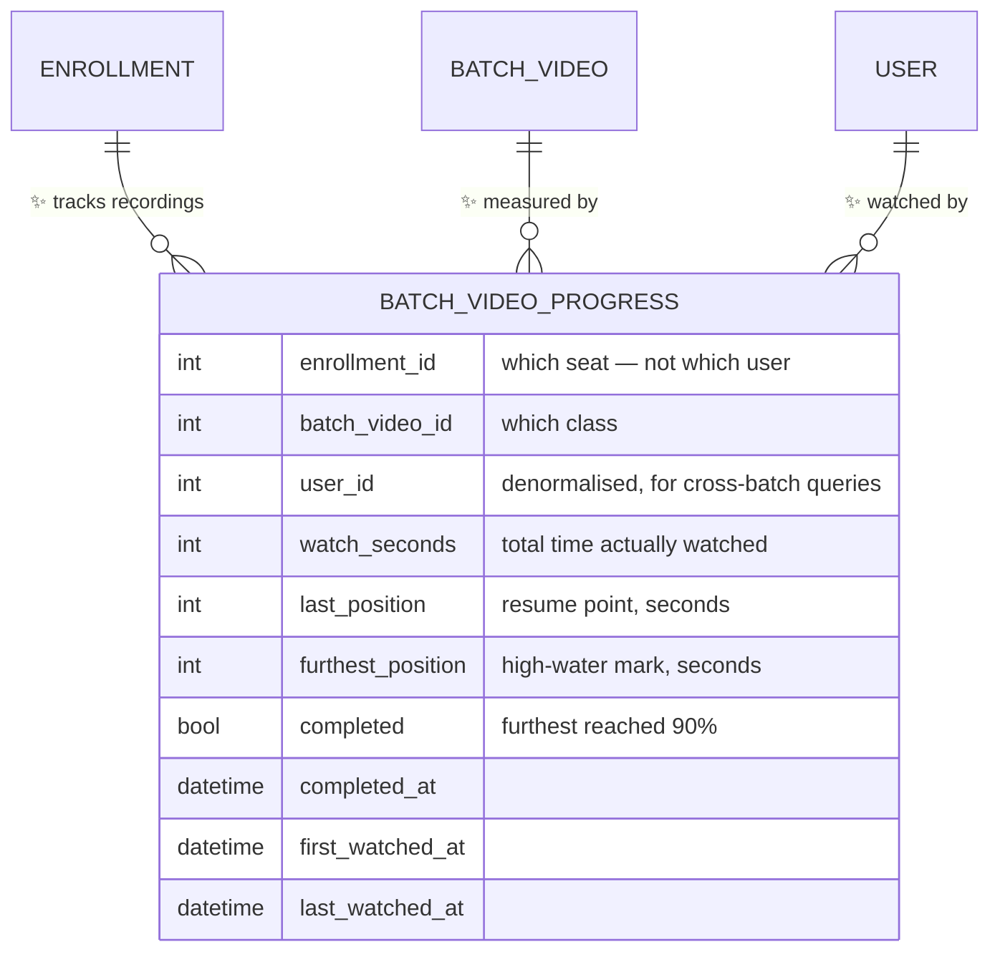
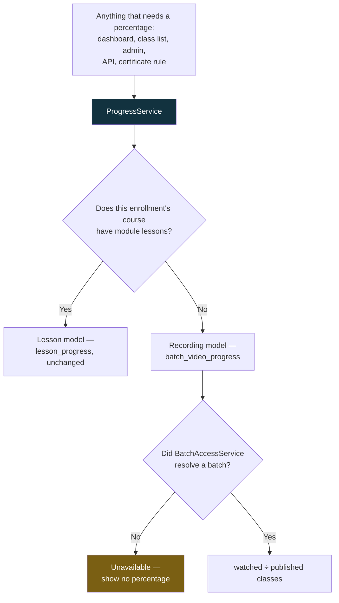
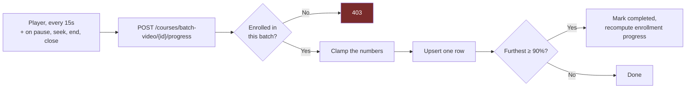
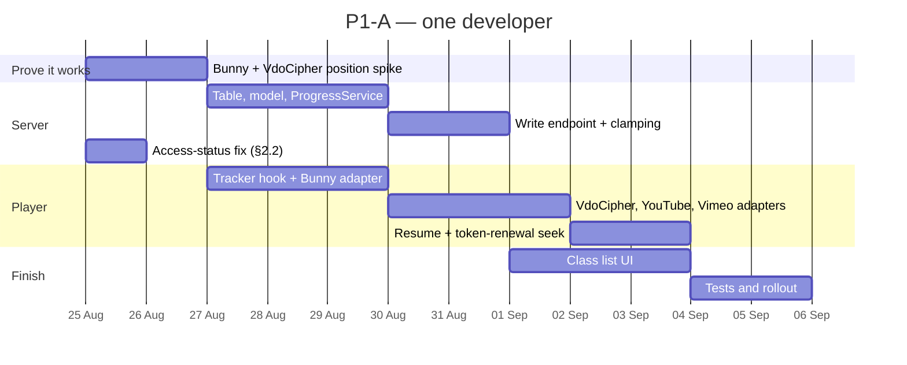

# P1-A — Progress Tracking for Recorded Classes

**Parent plan:** [Student Experience — Analysis & Enhancement Plan](STUDENT_UX_ENHANCEMENT_PLAN.md) §4.3
**Scope:** The website only. One course, sold by batch enrollment.
**Date:** 17 August 2026
**Status:** Build plan — ready for a go/no-go decision on §3
**Audience:** Founders and product for §1–§3, engineering for §4 onward
**Blocks:** P1-B (honest dashboard tiles), P2-A (My Batch page), P2-B (attendance view), P3-A (certificates)

---

## How to read this document

§1–§3 are the decision. They say what the student gets, what we found in the code
that the parent plan did not know, and the four questions that need an answer before
anyone writes code. **If you read nothing else, read §3.**

§4 onward is the build. It assumes the answers in §3 and can be skipped by
non-technical readers entirely.

---

## 1. What we are building

Today a student watches twelve recorded classes and the platform remembers nothing.
Close the tab, come back tomorrow, and every class looks exactly as untouched as it
did on day one.

After P1-A:

| | Today | After P1-A |
|---|---|---|
| Class list | Twenty identical rows | Watched rows ticked, the one in progress showing a part-filled bar |
| Reopening a class | Starts at 00:00 | Resumes at the second they stopped |
| "How far am I?" | No answer exists | "12 of 20 classes watched — 60%" |
| Admin student view | Enrolled / not enrolled | A real completion figure per student |

**A class counts as watched at 90% viewed.** Batch progress is watched classes ÷
published classes in that batch.

That is the whole of P1-A. It ships **no new page**: the numbers appear on the class
list the student already uses. The dashboard tiles that read from it are P1-B, a
separate and much smaller piece of work.

---

## 2. What the code review changed

The parent plan sized this at "one new table, one service, one endpoint". The table
is the easy part. Five things found in the application repository change the shape of
the work, and two of them are shipping blockers.

### 2.1 🔴 We cannot currently see what the player is doing

This is the real work in P1-A, and the parent plan does not mention it.

A recorded class is not a video tag on our page. It is **someone else's video player
inside an iframe on someone else's domain**. The browser deliberately forbids us from
reading anything inside it — including the playback position, which is the one number
this entire feature is built on.

Every provider offers a supported way to ask across that boundary, but each is
different, and each has to be built and tested separately:

| Source | Used for | How we read position | Confidence |
|---|---|---|---|
| **Bunny Stream** | The current default for new classes | Bunny's `player.js` bridge | High — documented, but needs a half-day spike to confirm against our library settings |
| **VdoCipher** | DRM-protected classes | VdoCipher's `v2/api.js` player instance | High — documented |
| **YouTube** | Some classes | YouTube IFrame API | High — our embeds already carry `enablejsapi=1` |
| **Vimeo** | Some classes | Vimeo Player SDK | High |
| **Bunny CDN (legacy)** | Older classes | It is a plain video element — trivial | Certain |

**What this means commercially:** the feature works everywhere or it works nowhere,
because a student cannot tell which provider a class happens to use. A progress bar
that moves on classes 1–8 and not on 9–20 is worse than no progress bar.

**Recommendation:** build the Bunny Stream and VdoCipher readers first — between them
they cover current and DRM classes — and treat YouTube and Vimeo as fast-follows
inside the same piece of work. Any class whose provider is not yet wired reports
nothing and shows no bar, rather than showing a bar stuck at zero.

> **Technical note.** A `usePlaybackTracker` hook with one adapter per `video_type`,
> each resolving to a common shape: `{ onTime(position, duration), onPause(),
> onEnded(), seekTo(seconds) }`. The adapter is chosen inside `VideoPlayer.jsx`,
> which is already the single place that branches on `video_type`. External provider
> SDKs load lazily, per adapter, so a Bunny page never fetches Vimeo's script.
> Where a provider script cannot be reached, the adapter resolves to a no-op and the
> UI hides the bar for that class — never a zero bar.

### 2.2 🔴 Auto-completion would lock students out of their own recordings

**The trap.** The existing `Enrollment::calculateProgress()` does two things: it
computes a percentage, and when that percentage reaches 100 it flips the enrollment's
status to `completed`.

Meanwhile the three endpoints that actually serve a video — the watch page, the
VdoCipher OTP and the Bunny token — each require the enrollment status to be
**`active`**, and only `active`.

So the moment a diligent student finishes their last class, the system would mark
them complete and their videos would stop playing. The student who did everything
right is the one we lock out.

> **Technical note.** `CourseController::watchClass()`, `batchVideoOtp()` and
> `batchVideoBunnyToken()` each check `->where('status', 'active')`. The model already
> publishes the correct list as `Enrollment::ACCESS_STATUSES = ['active',
> 'completed']`, with a comment explaining exactly why `completed` belongs in it —
> the three endpoints simply predate it and were never migrated. `BatchAccessService`
> is already correct.

**This must be fixed inside P1-A**, not after it, because P1-A is what makes
`completed` reachable for a batch student for the first time. It is a three-line fix
plus a test, and it is not optional.

**Second decision it forces:** should reaching 100% of recordings mark the enrollment
`completed` at all? Watching every recording is not the same as finishing the course —
the batch may still be running, with live classes to come. See §3, question 2.

### 2.3 🟠 Half the classes may have no duration recorded

`duration_seconds` on a recorded class is optional, and nothing enforces it. A 90%
rule needs a denominator; a class with no duration can never be marked watched.

**Handling:** the player knows the real duration the moment the video loads. The first
progress report for a class carries it, and we write it back to the class record if it
is missing. The gap self-heals as students watch, and admins never have to type a
number.

### 2.4 🟠 Long classes currently restart at 59 minutes — and P1-A fixes it

A Bunny playback link expires after an hour. The player renews it a minute before
expiry by reloading the iframe with a fresh link — **which restarts the video at
00:00.** Any class longer than 59 minutes does this to every student, every time.

Nobody logged this because there is no way to report "the video jumped back to the
start" that sounds like a bug rather than a mistake.

Once we know the playback position, the renewal can seek straight back to it. This
costs roughly an hour of extra work on top of the resume feature we are building
anyway, and it is the single most visible improvement in P1-A for anyone watching a
full-length class.

### 2.5 🟡 Which classes count, for a seat with no batch

Progress is *watched ÷ published classes in the batch*. Enrollments created before
batches existed carry no batch, and the access service recovers a batch for them by
looking at the order line, or — for a single-batch course — by inference.

**Rule adopted:** the denominator is the published classes of the batches
`BatchAccessService` resolves for that enrollment. Where it resolves none, progress is
reported as *unavailable* rather than 0%. A student is never shown a percentage
computed against a set of classes we are not confident about.

Cleaning these rows up is P1-D, and it runs alongside this work.

---

## 3. Four questions before we start

Engineering can begin on §4.1 and §4.2 today. These four gate everything after that.

| # | Question | Recommendation | Why it matters |
|---|---|---|---|
| **1** | Is 90% the completion threshold? | **Yes, 90%** | Standard, and it forgives end credits and a student who closes the tab as the instructor says goodbye. Store it as configuration, not a hardcoded number, so P3-A can tune it without a migration. |
| **2** | Should 100% watched mark the enrollment `completed`? | **No — not in P1-A** | The batch may still be running. Let `progress` reach 100 while `status` stays `active`; let the batch's end date and P3-A's certificate rule decide what "completed" means. This also sidesteps §2.2 entirely as a second line of defence. |
| **3** | Do we show historical students 0%, or hide the bar? | **Show it, with a dated note** | "Progress tracking started 8 September 2026." Students who watched everything in Batch 6 will otherwise read 0% as the platform forgetting them. Honest and dated beats silently wrong. |
| **4** | Do admins see per-student progress in this phase? | **Read-only, one column** | The existing admin enrollment list gains a real percentage. No new screen, no new report — those follow the data once it exists. |

> Question 2 is the one worth a real conversation. Everything else has an obvious
> answer and is written here mainly so nobody has to re-derive it in a standup.

---

## 4. The build

### 4.1 Data

One new table. Nothing existing changes shape.

**Why `furthest_position` as well as `last_position`:** a student who watches to the
end and then scrubs back to re-check something at minute 3 has not un-watched the
class. Completion reads the high-water mark; resume reads the last position.

**Why progress hangs off the enrollment, not the user:** a student who buys the
follow-up batch of the same course starts that batch at zero, with their first batch
untouched. This is exactly what the platform gets wrong today.

> **Technical note.**
> - Migration `create_batch_video_progress_table`, unique on
>   (`enrollment_id`, `batch_video_id`), indexes on (`enrollment_id`, `completed`) and
>   (`user_id`, `batch_video_id`). Both foreign keys cascade on delete.
> - Model `app/Models/BatchVideoProgress.php`; `Enrollment::batchVideoProgress()`
>   relation alongside the existing `lessonProgress()`.
> - The column set deliberately mirrors `lesson_progress` so the two models can be
>   read by one service without translation.

### 4.2 One service that answers "how far is this student"

`app/Services/ProgressService.php` becomes the only place in the codebase that
computes progress, for either content model.

The point of the service is not tidiness. It is that the dashboard, the class list,
the admin column and — later — the certificate rule must be **incapable of
disagreeing** about whether a student has finished. Four independent calculations of
the same number is how a student ends up 100% complete on one screen and 94% on
another, and how a certificate gets issued to someone who did not earn it.

`Enrollment::calculateProgress()` keeps its signature and delegates here, so every
existing caller keeps working.

### 4.3 The write endpoint

**Clamping matters.** The browser is not trustworthy: anyone can post
`watch_seconds: 999999`. Three limits, all server-side:

1. Position can never exceed the class's known duration.
2. Watch time added per request can never exceed the wall-clock time since that
   student's previous request for that class.
3. Total watch time can never exceed 3× the class duration — generous enough for
   genuine rewatching, tight enough that the admin column stays meaningful.

> **Technical note.** New `app/Http/Controllers/BatchVideoProgressController.php` —
> `CourseController` is already 1,374 lines and should not absorb this. Route inside
> the existing `auth:web` + `EnsureEmailIsVerified` group, throttled at 30/minute
> (a legitimate player sends 4/minute). The same `BatchAccessService::canWatchVideo()`
> check the playback endpoints use, plus the published check. Responds `204` — the
> player has nothing to do with the answer, and a body is wasted bandwidth on a
> request that fires every 15 seconds.
>
> The final report on tab close goes through `navigator.sendBeacon`, which survives
> the page unloading where `fetch` does not. Beacons cannot set custom headers, so the
> route must accept a plain form-encoded body and the CSRF token travels in the
> payload.

### 4.4 What changes on screen

Small, and all of it inside components that already exist.

| Where | Change |
|---|---|
| Class list (`LearnClassList.jsx`) | Tick on watched rows; a thin part-filled bar on the one in progress |
| Class list header | "12 of 20 classes watched — 60%" |
| Learn page | "Continue where you left off" — opens the furthest incomplete class at its resume point |
| Watch page (`ClassWatch.jsx`) | Resumes at the saved second, with a one-time "Resuming from 24:10 — start over?" affordance |
| Player (`VideoPlayer.jsx`) | The tracker hook; the seek-back on Bunny token renewal from §2.4 |
| Historical batches | The dated note from §3, question 3 |

> **Technical note.** `recordedClassPayload()` currently hardcodes `'completed' =>
> false` for every class — that is the hook point. It gains `completed`,
> `last_position` and `percent` from a progress map the controller loads once per
> page, keyed by `batch_video_id`. One extra query on the learn page, none per row.

---

## 5. Sequencing

**Roughly two and a half weeks**, against the parent plan's ten days. The difference
is entirely §2.1 — the provider adapters — and the two-day spike at the front exists
so we find out in week one if that estimate is wrong.

**The spike is a genuine go/no-go.** If Bunny's bridge does not deliver a reliable
position under our DRM and token settings, the fallback is coarser progress —
"opened" and "reached the end" only, driven by player start and end events, which
every provider gives us cheaply. That fallback still unblocks P1-B and P2-A. It does
not support resume, and it would make the certificate rule in P3-A weaker. We would
want to know that in week one, not week three.

**The access-status fix runs on day one, independently**, because it is a live bug
today for any student an admin has manually marked completed.

---

## 6. How we will know it worked

| Check | Where | Passes when |
|---|---|---|
| Positions are read | Spike | Bunny and VdoCipher both report a position within 1s of the truth |
| Nothing regressed | `BatchVideoAccessTest` | Still green, plus a new case for a `completed` student playing a video |
| Progress is real | New `BatchVideoProgressTest` | Watching to 90% marks complete; 89% does not; the wrong batch gets 403; inflated watch time is clamped |
| The right seat is credited | New test | A student in two batches of one course writes progress against the batch whose page they are on |
| Students see it | Production, week 1 | >90% of students who open a class have a non-zero progress row within 48 hours |
| The bar is honest | Production, week 2 | Spot-check ten students: the platform's percentage matches what they actually watched |

The last one is not a formality. The failure mode of this feature is not a crash —
it is a bar that moves plausibly and means nothing, which nobody notices until the
first certificate is issued to someone who watched three classes.

---

## 7. What P1-A explicitly does not include

Stated so that scope creep has to be an argument rather than an assumption:

- **No new page.** No `/my-batch`. That is P2-A.
- **No dashboard tile changes.** That is P1-B, four days, once this data exists.
- **No certificates.** That is P3-A, and it needs attendance too.
- **No attendance.** Already collected, already correct, still not student-visible.
- **No mobile app.** The API surface is unchanged; the app keeps behaving as it does.
- **No backfill.** We will not invent progress for classes watched before tracking
  existed. §3, question 3 covers what students are told instead.

---

## 8. Risks

| Risk | Likelihood | Handling |
|---|---|---|
| A provider's bridge does not give a usable position | Medium | The week-one spike, and the coarse-progress fallback in §5 |
| A student's progress is credited to the wrong batch | Low | Progress keys on `enrollment_id`, never `user_id` + `course_id`; covered by a test |
| Write traffic from 15-second saves | Low | ~4 writes per student per viewing hour, on a single upsert against a unique key |
| Students game the percentage | Low | Server-side clamping (§4.3). Worth noting the incentive only becomes real once a certificate exists — which is why the clamps ship now, before P3-A, rather than after someone finds the hole |
| The `completed` status lockout ships unnoticed | **High if not planned for** | Day-one fix, its own test, and §3 question 2 as a second line of defence |
| Scope creeps into P1-B and P2-A | Medium | §7. P1-A is demonstrable on the existing class list or it is not P1-A |

---

## 9. Recommended decision

**Proceed, with the two-day spike as a hard checkpoint.**

The parent plan is right that this is the first thing to build — four later phases
read from this table, and building any of them first means building them twice. The
review did not find a reason to reorder. It found that the job is about a week larger
than estimated, that a live access bug is sitting in the path, and that a long-standing
"video restarts at 59 minutes" annoyance gets fixed for free along the way.

What we need from the business is §3 — and really only question 2.

---

*Next document in the series: P1-C, the welcome checklist — the other Phase 1 item
that can start immediately, because it shares no code with this one.*
