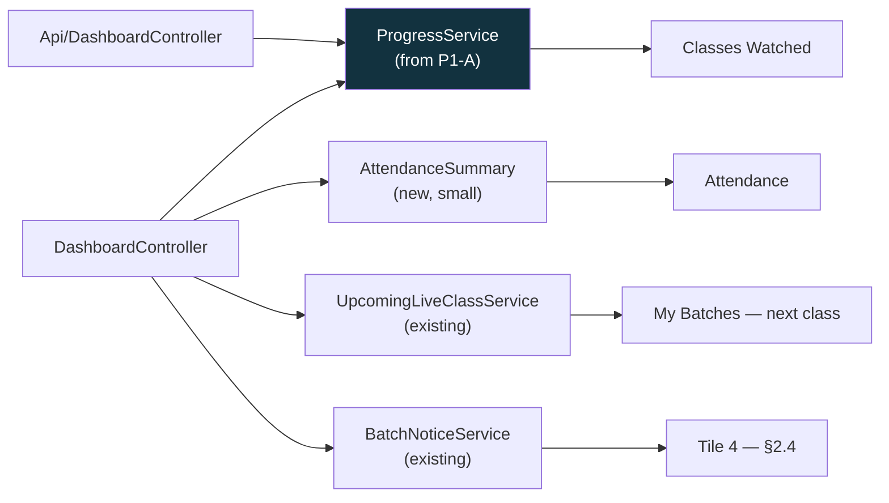
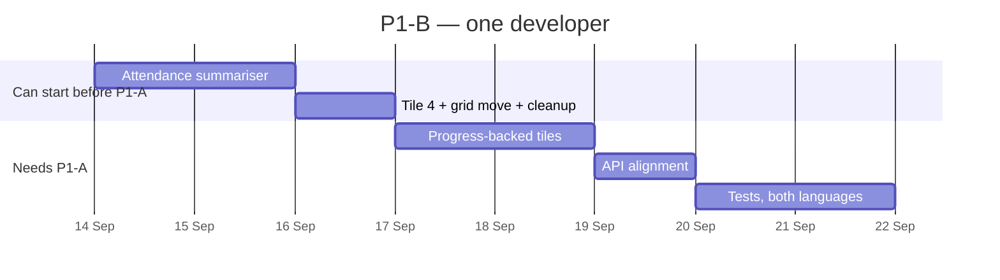

# P1-B — Honest Dashboard Tiles

**Parent plan:** [Student Experience — Analysis & Enhancement Plan](STUDENT_UX_ENHANCEMENT_PLAN.md) §3.1, §4.3
**Siblings:** [P1-A](P1A_RECORDING_PROGRESS_PLAN.md) · [P1-C](P1C_WELCOME_CHECKLIST_PLAN.md) · [P1-D](P1D_DATA_INTEGRITY_PLAN.md)
**Scope:** The website. One course, sold by batch enrollment. Touches the mobile API — see §2.5.
**Date:** 17 August 2026
**Status:** Build plan — ready for a go/no-go decision on §3
**Depends on:** **P1-A.** Two of the four tiles cannot be built before it.

---

## 1. What we are building

Four numbers on the student dashboard. Three of them are currently wrong for every
batch student, permanently, by construction:

| Tile | Today | Why it is wrong |
|---|---|---|
| Total Courses | A number | Correct, but "courses" is not the word — they bought a *batch* |
| Completed | Always 0 | Counts enrollments at 100% lesson progress; batch courses have no lessons |
| Watch Time | Always 0h 0m | Sums lesson watch time; batch students have no lesson rows |
| Certificates | Always 0 | There is no certificate record anywhere in the system |

After P1-B they say something true:

```
┌──────────────┬──────────────┬──────────────┬──────────────┐
│  My Batches  │   Classes    │  Attendance  │   ? see §2.4 │
│              │   Watched    │              │              │
│      1       │  12 of 20    │   9 of 11    │              │
│ next: Tue 9pm│     60%      │  live classes│              │
└──────────────┴──────────────┴──────────────┴──────────────┘
```

**This is the smallest item in Phase 1 and the one a student notices first.** It is
also the only one that is pure payoff — it builds no new mechanism, it just stops four
tiles from lying using data the other three items produce.

---

## 2. What the code review found

### 2.1 🟠 The tiles are at the bottom of the page

The parent plan calls the stat tiles *"the first thing a student sees that is factually
wrong"*. They are in fact the **last** thing on the dashboard — below the live classes,
below the four action tiles, below the course cards, below the recommended courses. On
a phone they are several screens down.

That does not make the fix wrong. It makes it worth asking whether the tiles are worth
fixing *in place*. Four honest numbers nobody scrolls to are still four numbers nobody
scrolls to.

**Recommendation:** move the grid above the course cards as part of this work. It is a
block move in one file, it costs almost nothing, and it is the difference between this
item mattering and this item being technically complete.

### 2.2 🟠 The attendance tile pulls Phase 2's data work forward

Tile 3 needs attendance. The parent plan schedules attendance as **P2-B**, after the My
Batch page — but P1-B cannot render this tile without it.

The good news is that the data is already there and already correct: one row per
student per live class, unique on that pair, so reconnects accumulate into a single row
rather than reading as separate attendances. Counting is cheap.

The care is all in the **denominator**. "9 of 11" is only honest if the 11 excludes
demo classes, cancelled classes and classes that have not happened yet, across only the
batches this student holds.

> **Technical note.** `live_class_attendances` is unique on
> (`live_class_id`, `user_id`). The denominator is `LiveClass::visibleTo($user)`
> — the scope that already backs every batch-scoped class surface — narrowed by
> `real()` (excludes demo) and `past()`. Note that `scopePast()` currently admits
> `cancelled` alongside `completed`; a cancelled class must not count against a
> student, so the tile needs its own narrowing rather than reusing `past()` as-is.

**This does not duplicate P2-B.** It means P1-B builds the *number* and P2-B builds the
*view* — the per-class Attended / Partial / Missed breakdown. Worth stating plainly so
the two do not get built twice.

### 2.3 🟠 Watch Time could stay — P1-A makes it real

The parent plan replaces the Watch Time tile because it always reads zero. But P1-A's
progress table records `watch_seconds` per class, so **watch time stops being a lie the
moment P1-A ships.** It was never a bad metric; it was an unpopulated one.

**Recommendation: still replace it on the web dashboard.** For a batch product,
"attended 9 of 11 live classes" tells a student something about their standing in the
cohort that "6h 20m" does not. But the underlying number now exists, which matters for
§2.5 and for admin reporting.

### 2.4 🔴 The certificate tile has nothing honest to say yet

The parent plan proposes the fourth tile show *"3 classes away"* until certificates ship
in P3-A.

**Three classes away from what?** The eligibility rule — 80% watched, 70% attended — is
a *proposal* in P3-A, and §9 question 1 of the parent plan explicitly asks the business
whether it is right, including whether attendance should count at all.

So the tile would count down to a threshold nobody has agreed to. If the rule changes,
every student's countdown changes retroactively, and we will have made a specific
numeric promise before deciding what the promise is. That is the same mistake as the
current permanently-zero counter, dressed better.

**Three options:**

| Option | Tile 4 becomes | Verdict |
|---|---|---|
| **A. Something real now** | **Unread notices**, or **next class countdown** — true today, useful today | **Recommended** |
| B. Neutral certificate tile | "Certificate — available after your batch ends", no number | Acceptable. Honest, but says nothing |
| C. Countdown to the proposed rule | "3 classes away" | Not recommended until §9 q1 is answered |

**Recommendation: option A.** Ship four tiles that are all true. Add the certificate
tile in P3-A, when there is a rule to count toward and a certificate to collect.

### 2.5 🟠 The mobile API computes the same broken numbers separately

There is a second dashboard — `/api/dashboard`, consumed by the mobile app — with its
own copy of the same lesson-based arithmetic, including its own `total_watch_time` that
is always zero for batch students.

Mobile is out of scope for the parent plan, and this plan does not propose changing the
app. But if the web dashboard is fixed and the API is not, the same student sees
different numbers on their phone and their laptop, and we have two wrong
implementations instead of one.

**Recommendation:** point the API at the same `ProgressService` P1-A introduces,
**keeping its response shape exactly as it is.** No new keys, no removed keys, no app
release required — the existing fields simply start carrying correct values, and
`total_watch_time` becomes real (§2.3). Roughly half a day, and it retires the second
copy of the maths for good.

### 2.6 🟡 Two small things while we are in this file

- **`inProgressCourses` is computed on every dashboard load and never rendered.** Delete it.
- **The enrollment loop runs two queries per card.** The controller already demonstrates
  the right pattern immediately above — it counts recorded videos for all batches in one
  grouped query specifically to avoid an N+1 — and then does not apply it to the lesson
  progress lookups just below. P1-B adds progress and attendance to that same loop, so
  batch the lookups rather than making it worse.

---

## 3. Two questions before we start

| # | Question | Recommendation |
|---|---|---|
| **1** | What is the fourth tile? | **Something true today** — unread notices or next class. Certificates arrive with P3-A (§2.4) |
| **2** | For a student in two batches, does "12 of 20" mean both batches summed, or one? | **Summed across active batches**, with the per-batch split on the My Batch page in P2-A |

On question 2: with a single course on sale, virtually every student has exactly one
batch today, so this decision costs nothing to make now and is awkward to retrofit
later. Summing keeps the dashboard what the parent plan says it should be — the
overview across batches — and leaves per-cohort depth to P2-A.

---

## 4. The build



Every tile reads from a service that already exists or that P1-A introduces. **P1-B
adds no new table and no new mechanism** — one small summariser for attendance counts,
and everything else is wiring.

| Tile | Source |
|---|---|
| My Batches | Active enrollments, plus the next class from `UpcomingLiveClassService` — the same source as the pinned countdown pill, so they cannot disagree |
| Classes Watched | `ProgressService`, summed across active batches |
| Attendance | New `AttendanceSummary`: rows in `live_class_attendances` ÷ past, real, non-cancelled classes for the student's batches |
| Tile 4 | `BatchNoticeService::unreadCountFor()` — already exists and is already called on this page |

> **Technical note.** Files: `DashboardController::index()`,
> `Api/DashboardController::index()`, `resources/js/Pages/Dashboard/Student.jsx`
> (lines ~479–536 for the grid, plus the block move from §2.1), new
> `app/Services/AttendanceSummary.php`, and Bengali + English strings for the four new
> labels. No migration.

**Historical batches.** A student whose batch ran before P1-A shipped will read
"0 of 20 watched" honestly but discouragingly. The same dated note P1-A adopts —
*"Progress tracking started on [date]"* — belongs on this tile too, from the same
source, so the two screens tell one story.

---

## 5. Sequencing



**About eight days.** The parent plan says four, and four is right for the tiles alone;
the extra covers the attendance summariser pulled forward from P2-B (§2.2), the API
alignment (§2.5) and translation.

**Roughly half of it can start before P1-A lands.** The attendance tile, the fourth
tile, the grid move and the cleanup have no dependency on progress tracking at all. If
P1-A's spike goes badly, P1-B still ships two honest tiles out of four, which is two
more than today.

### Where Phase 1 now stands

| Item | Parent estimate | Reviewed | Note |
|---|---|---|---|
| P1-A Progress tracking | 10d | ~12d | Provider adapters (§2.1 of that plan) |
| P1-B Dashboard tiles | 4d | ~8d | This document |
| P1-C Welcome checklist | 5d | ~9d | Phone verification flow does not exist |
| P1-D Data integrity | 3d | ~13d | Includes a 4-day hotfix that should not wait |
| **Total, one developer** | **22d** | **~42d** | **~8.5 weeks, not the ~3 the gantt implies** |

These items share almost no code, so the work parallelises well — three developers
brings it to roughly three weeks. **That is a resourcing decision and it should be made
now**, before a date is committed externally. The parent roadmap's gantt starts three
of these on the same day under a heading that says "one developer", which is where the
discrepancy originates.

---

## 6. How we will know it worked

| Check | Where | Passes when |
|---|---|---|
| No tile is structurally zero | New `DashboardTilesTest` | A batch student with progress and attendance sees four non-zero, correct tiles |
| The attendance denominator is honest | Same test | Cancelled, demo and future classes are all excluded; another batch's classes never count |
| Multi-batch sums correctly | Same test | A student in two batches sees the combined figure, matching the sum of the two My Batch pages |
| Web and mobile agree | New API test | `/api/dashboard` and `/dashboard` return the same numbers for the same student |
| No N+1 crept in | Query count assertion | Dashboard query count does not rise with the number of enrollments |
| Both languages | Manual | Every new label reads correctly in Bengali |
| Students notice | Production, week 2 | The parent plan's own target: >90% of active batch students showing progress above 0% |

---

## 7. What P1-B does not include

- **No new page**, no My Batch — that is P2-A.
- **No per-class attendance view** — the number only. P2-B builds the breakdown.
- **No certificate tile** — see §2.4. It arrives with P3-A.
- **No mobile app changes.** The API's response *shape* is untouched; only its values
  become correct.
- **No redesign.** Same grid, same styling, better numbers and a better position.

---

## 8. Risks

| Risk | Likelihood | Handling |
|---|---|---|
| P1-A slips and P1-B has nothing to read | Medium | Half of P1-B is independent (§5). Ship the honest half, add the rest when P1-A lands |
| The attendance denominator quietly misleads | Medium | It is the one piece of real arithmetic here. Explicit tests for cancelled, demo, future and other-batch classes |
| Historical students read 0% as the platform forgetting them | High | The dated note, shared with P1-A so both screens say the same thing |
| The API drifts again later | Low | It reads the shared service after this; there is no second implementation left to drift |
| "Fixing the tiles" expands into redesigning the dashboard | Medium | §7. If it is not one of four numbers or a block move, it is P2-A |

---

## 9. Recommended decision

**Proceed, and schedule it immediately after P1-A.**

P1-B is the cheapest item in Phase 1 and the most visible. It builds nothing new — it
is the moment the work in P1-A and P1-D becomes something a student can actually see,
which makes it the natural end of the phase rather than a footnote to it.

Two decisions needed, both small and both in §3: what the fourth tile shows, and what
the numbers mean for a student in more than one batch. Neither blocks the half of the
work that can start before P1-A.

The one thing worth carrying out of this document beyond the tiles themselves is the
table in §5. Phase 1 is about 8.5 weeks of work for one developer against a roadmap
drawn for 3. That is not a problem with the plan — the plan is sound and the review did
not reorder a single item. It is a staffing question, and it is better answered in
August than in October.

---

*Phase 1 is now fully planned: [P1-A](P1A_RECORDING_PROGRESS_PLAN.md) ·
P1-B (this document) · [P1-C](P1C_WELCOME_CHECKLIST_PLAN.md) ·
[P1-D](P1D_DATA_INTEGRITY_PLAN.md).
Phase 2 begins with **P2-A, the My Batch page** — the largest single item in the parent
plan, and the first one that adds a destination rather than fixing one.*
