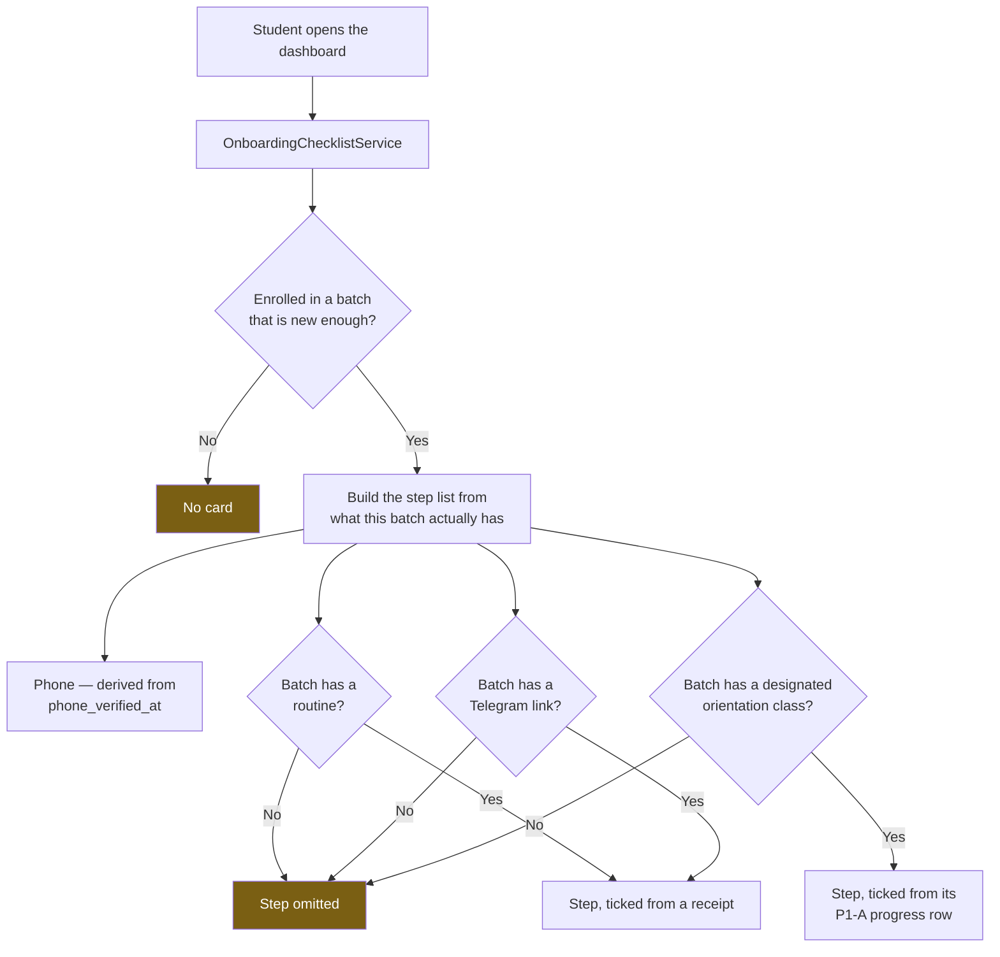
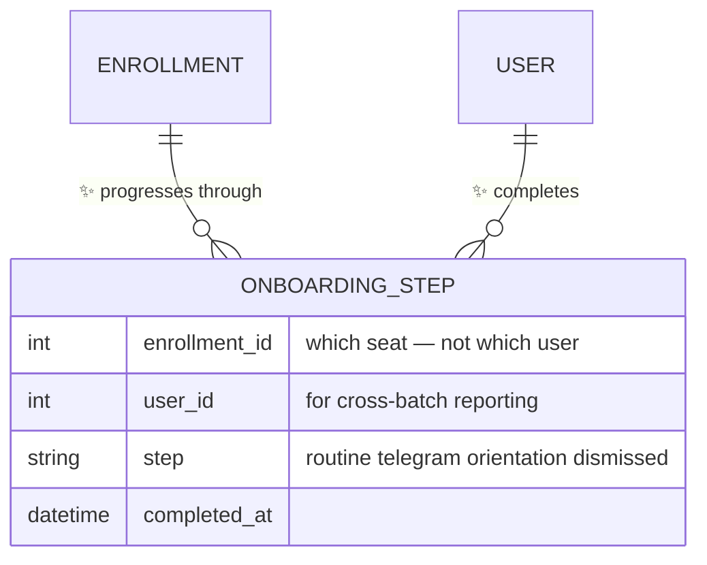
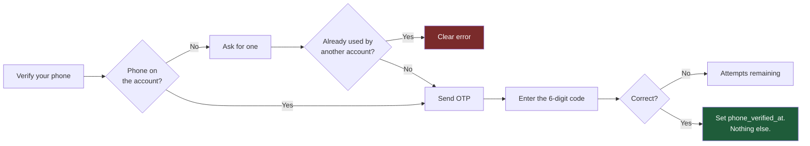
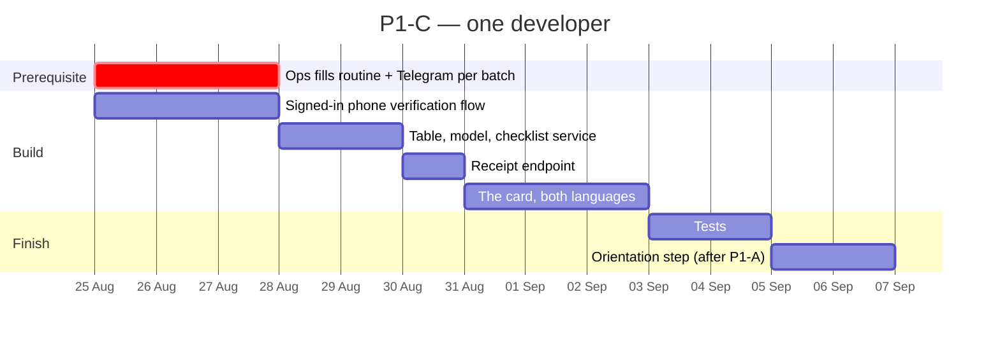

# P1-C — The Welcome Checklist

**Parent plan:** [Student Experience — Analysis & Enhancement Plan](STUDENT_UX_ENHANCEMENT_PLAN.md) §4.3
**Sibling:** [P1-A — Progress Tracking for Recorded Classes](P1A_RECORDING_PROGRESS_PLAN.md)
**Scope:** The website only. One course, sold by batch enrollment.
**Date:** 17 August 2026
**Status:** Build plan — ready for a go/no-go decision on §3
**Audience:** §1–§3 for founders, product and **operations**; §4 onward for engineering
**Blocks:** Nothing. This is the one Phase 1 item nothing else waits on.

---

## How to read this document

§1–§3 are the decision. §3 contains one question that is **not** an engineering
question — it is an operations commitment, and without it this feature cannot ship in
a working state. Please do not skip it.

§4 onward is the build.

---

## 1. What we are building

The gap this closes is §3.6 of the parent plan: *nothing happens between "payment
succeeded" and "first class".* A student pays, sees a success page, and then hears
nothing — through the highest-anxiety, highest-refund-risk window in the whole
journey.

The fix is a card at the top of the dashboard, for new students only, that turns that
silence into three or four obvious next actions:

```
┌────────────────────────────────────────────────────────┐
│  Welcome to Batch 7 — starts 1 September               │
│  2 of 4 done                          ▓▓▓▓▓▓░░░░░░     │
│                                                        │
│  ✓  Verify your phone number                           │
│  ✓  See the class routine                              │
│  ○  Join the Batch 7 Telegram group          [Open →]  │
│  ○  Watch the orientation video              [Watch →] │
│                                                        │
│                                       Dismiss this card│
└────────────────────────────────────────────────────────┘
```

Each row links straight to the thing. Steps already satisfied arrive ticked. The card
disappears when the student finishes or dismisses it.

**Why this is worth building before anything prettier:** every slowly-filling Telegram
group and every "did my payment go through?" ticket starts in this window. It is the
cheapest activation lever in the parent plan, and it is the only Phase 1 item with no
downstream dependencies — nothing waits on it, so it can be built at any time by
anyone.

---

## 2. What the code review changed

The parent plan sized this at **S — under a week** and noted "no new table needed —
completion is derived from existing records". The derivation is indeed easy. The
problem is that **three of the four steps have nothing to link to.**

### 2.1 🔴 "Verify your phone" has no destination

This is the bulk of the work, and the parent plan does not mention it.

Reading whether a phone is verified is trivial — `phone_verified_at` on the user.
But **a logged-in student has no way to verify their phone.** The entire OTP flow is
registration-only: it identifies the user from a session key set during signup, and if
that key is absent it redirects to the registration page. A student who clicks
"Verify your phone" today lands on a signup form.

Worse, the flow cannot simply be reused. On success it logs the user in, and it sets
`email_verified_at` as a side effect — neither of which is correct or safe for someone
who is already signed in.

**And this affects nearly every batch student.** Quick checkout — the main way a seat
is bought — creates the account with the email pre-verified and the phone left
unverified. So the typical batch buyer has an unverified phone by construction, and no
route to fix it.

> **Technical note.** `PhoneVerificationController` keys off
> `session('pending_phone_user_id')` and falls through to `redirect()->route('register')`
> in all three actions. On success it does `Auth::guard('web')->login($user)` and
> `$user->email_verified_at = now()`. `QuickCheckoutController` creates the user with
> `'email_verified_at' => now()` and never touches `phone_verified_at`.
> `EnsureEmailIsVerified` only enforces phone verification for accounts with **no**
> email, so an email-registered student is never prompted.

**Why it is worth the work rather than dropping the step.** An unverified phone is not
a cosmetic gap. Password reset by OTP is a primary login recovery path here, and the
admin's bulk student messaging sends SMS per batch — it already reports how many
recipients have no usable number. An unreachable phone means a student who cannot get
back into their account and does not receive the message about tomorrow's class.

### 2.2 🔴 Two steps may point at nothing, and the platform will not fake it

The class routine and the Telegram link are **per-batch fields that both ship empty**,
and the service that reads them deliberately refuses to substitute anything:

| Step | Field | Default | If empty |
|---|---|---|---|
| See the class routine | `batches.class_routine` + `class_routine_enabled` | Empty, and **off** | No target at all |
| Join the Telegram group | `batches.telegram_link` | Empty | No target — and it will **not** fall back to the public Telegram group |

That refusal is correct and should not be changed: a student who is not in a batch
with its own group is not meant to be in that group. But it means a checklist built
naively would show two steps that can never be ticked, for a batch whose admin has not
filled the fields in.

**A checklist with permanently un-completable steps is worse than no checklist.** It
converts "we forgot to tell you what to do" into "we told you to do something
impossible".

**Handling — two parts, and both are needed:**

1. **Engineering:** the checklist is *composed from what the batch actually has*. A
   batch with no Telegram link simply does not show that step, and the counter says
   "2 of 3", not "2 of 4". Never a permanently grey row.
2. **Operations:** somebody has to fill those two fields in for the live batch before
   this ships. See §3, question 1. This is the part that cannot be solved in code.

### 2.3 🟠 We cannot know whether a student joined Telegram

We hand out a link to Telegram. What happens on the other side is invisible to us —
we can record that a student *clicked*, never that they *joined*.

So the tick has to mean what it can honestly mean. Two options:

| | What the tick means | Cost |
|---|---|---|
| **Click-through (recommended)** | "You opened the group link" | Included in this plan |
| Bot-verified membership | "You are actually in the group" | A Telegram bot, deep-link tokens, an admin bot in every group — its own project, well beyond Phase 1 |

**Recommendation: click-through, labelled honestly.** The row reads *"Join the Batch 7
Telegram group"* and once opened becomes *"Telegram group opened"* rather than a bare
tick. If group membership turns out to be the number the business actually wants to
manage, that is a separate piece of work worth costing on its own.

### 2.4 🟠 There is no orientation video, and the parent plan's mechanism cannot work

The parent plan proposes tracking step 4 with "a `batch_video_progress` row for the
orientation video". That is not possible: the only orientation-shaped thing on the
platform is the **site-wide welcome clip** set in Admin → Settings, and it has no
recorded-class record behind it — so it cannot have a progress row, because that table
is keyed to a class. It is also only rendered on the learn page, and only for courses
with no module lessons.

Three ways forward:

| Option | What step 4 becomes | Verdict |
|---|---|---|
| **A. Designate a class as the orientation** | A flag on one of the batch's published classes; the step points there and ticks from its P1-A progress row | **Recommended** — real content, and reuses P1-A rather than inventing a mechanism |
| B. Point at the site-wide welcome clip | Ticks on "opened", not on "watched" | Works, but the clip is generic marketing, not batch orientation |
| C. Ship three steps | Drop it | Perfectly acceptable — the other three carry the feature |

Option A introduces the only real coupling between P1-C and P1-A. **It is a
fast-follow, not a dependency:** ship three steps now, add the fourth when P1-A lands
and an admin has designated a class.

### 2.5 🟡 "No new table needed" is not quite right

Phone verification is derivable. The other three steps are not — clicking a Telegram
link, opening the routine and dismissing the card all leave no trace anywhere today.

The parent plan gestures at "notice-read-style receipts", which is the right instinct:
the notice board already solved exactly this problem by moving read state out of the
browser and into a row per student per notice. The same reasoning applies here — a
student who ticks three steps on their phone must not see an empty checklist on their
laptop.

The alternative — stashing a blob in the existing `enrollments.metadata` JSON column —
avoids a migration and costs us the measurement. One of the parent plan's own success
targets is *"welcome checklist completed within 48 hours > 70%"*, and that is a
straightforward query against a table and an awkward one against JSON.

**One small table. It is worth the migration.**

---

## 3. Three questions before we start

| # | Question | Recommendation | Who answers |
|---|---|---|---|
| **1** | **Will the routine and Telegram link be filled in for the live batch before launch?** | **Yes — treat it as a launch blocker** | Operations, not engineering |
| **2** | Three steps or four? | **Ship three. Add orientation as a fast-follow after P1-A** | Product |
| **3** | When does the card disappear? | **When complete or dismissed — anchored to the batch start date, not a 7-day purchase timer** | Product |

### On question 1 — the one that actually matters

Everything in §2.2 comes down to this. Engineering can build a checklist that
gracefully hides steps a batch has not configured, and it should. But a student whose
batch has neither a routine nor a Telegram link will see a one-step checklist that
says "verify your phone", which is not a welcome — it is a chore.

This feature's value is roughly proportional to how completely those two fields are
filled in. It is ten minutes of admin work per batch. It needs an owner and a date.

### On question 3 — why not 7 days

The parent plan proposes "the first 7 days". Batches have their own enrollment window,
and a student can buy a seat weeks before the batch begins. A 7-day timer from purchase
would hide the card from exactly the student it is meant to serve — the one who bought
early and is waiting.

**Recommendation:** the card shows from enrollment until the student completes or
dismisses it, and auto-retires two weeks after the batch's start date. It is welcome
material; by the time a cohort is a fortnight in, it has stopped being welcome and
started being clutter.

---

## 4. The build

### 4.1 The shape of it



The service is the whole design. Everything else is plumbing around it.

### 4.2 Data — one table



**Per enrollment, not per user** — the same principle as P1-A. A student in two
batches has two Telegram groups and two routines, and finishing one cohort's checklist
must not silently tick the other's.

**Phone is not in this table.** It is a property of the person, read from
`phone_verified_at`, and it stays ticked across every batch they ever join. Storing a
copy would let the two disagree.

> **Technical note.** Migration `create_onboarding_steps_table`, unique on
> (`enrollment_id`, `step`), index on (`user_id`, `step`) for the 48-hour completion
> metric. `step` is a short string validated against a constant list in the model
> rather than a database enum — the step set will change as the checklist earns its
> keep, and an enum makes that a migration every time.

### 4.3 Phone verification for a signed-in student

A new, separate flow. The registration controller is left exactly as it is.



**"Nothing else" is the important part.** This flow sets one column. It does not log
anyone in, does not touch `email_verified_at`, and does not run the suspension check
that belongs to a login.

> **Technical note.** New `app/Http/Controllers/Auth/PhoneConfirmationController.php`
> behind `auth:web`. It reuses `SmsService`, the same 6-digit / 10-minute /
> 5-attempt / 60-second-resend policy as registration, and `PhoneNumber::normalize()`
> plus the `unique:users,phone` rule that `ProfileController` already applies.
>
> **Namespace the cache keys.** Registration stores its OTP at `phone_otp_{userId}`.
> If this flow reuses that key, a code minted for one purpose becomes redeemable for
> the other. Use a distinct prefix so an OTP can only ever be spent on the thing it
> was issued for.
>
> Rate-limit the send endpoint per user *and* per IP: it triggers an outbound SMS,
> which costs money, and it is the only such endpoint reachable by an ordinary
> logged-in student.

### 4.4 The receipt endpoint

One route, mirroring the notice-read receipt the platform already has:
`POST /onboarding/steps` with an enrollment id and a step name, validated against the
allowed list and against the student's own enrollments. Returns the refreshed
checklist so the card can re-render from one source rather than guessing locally.

The Telegram and routine steps post their receipt on click. Dismissal posts a
`dismissed` step. Phone and orientation post nothing — they are read from elsewhere.

### 4.5 What changes on screen

| Where | Change |
|---|---|
| `Dashboard/Student.jsx` | The card, above the stat tiles, when the service returns one |
| `Components/Dashboard/WelcomeChecklist.jsx` | New — the card itself |
| Routine step | Opens the routine dialog that already exists in `DashboardActionTiles.jsx` |
| Telegram step | Opens the batch link in a new tab, posts its receipt |
| Phone step | Links to the new verification flow |
| Bengali + English | Every string translated — this is the first screen a new student reads |

> **Technical note.** `DashboardController::index()` gains one service call. The
> routine and Telegram targets are already resolved for the tiles by
> `BatchActionService`; the checklist reads the same resolution rather than a second
> one, so the card and the tile can never disagree about whether a batch has a group.

---

## 5. Sequencing



**About nine working days, not five.** The difference is §2.1 — the phone verification
flow the parent plan assumed already existed. This makes P1-C an **M**, not an **S**.

**One scheduling note on the parent roadmap.** Its Phase 1 gantt starts P1-A (10 days),
P1-C (5 days) and P1-D (3 days) on the same date, under a heading that says "estimates
for one developer". That is 18 days of work in a 10-day span. These items genuinely
share no code — they can be interleaved, or split across two developers — but one
developer runs them in sequence, and Phase 1 is closer to five weeks than three. Worth
correcting before anyone commits to a date externally.

**If you want the fastest visible win:** P1-C ships something a student can see in
about nine days, where P1-A ships something visible in about two and a half weeks.
Nothing waits on P1-C, so it is a legitimate choice to run it first — the only cost is
that everything in Phases 2 and 3 keeps waiting.

---

## 6. How we will know it worked

| Check | Where | Passes when |
|---|---|---|
| The new flow verifies, and does nothing else | New `PhoneConfirmationTest` | Sets `phone_verified_at`; does not change `email_verified_at`; does not alter the session; a duplicate phone is a clear error |
| Registration is untouched | Existing OTP tests | Still green |
| An OTP cannot cross purposes | New test | A registration code is rejected by the confirmation endpoint, and the reverse |
| Empty batches degrade gracefully | New `WelcomeChecklistTest` | A batch with no routine and no link yields a one-step card, never a grey un-tickable row |
| Receipts are per seat | New test | Ticking Telegram in Batch 7 leaves Batch 6's checklist untouched |
| Receipts cannot be forged | New test | Posting another student's enrollment id is rejected |
| It actually gets used | Production, week 2 | >70% of new students complete every available step within 48 hours *(the parent plan's own target)* |
| It is not just being dismissed | Production, week 2 | Dismissals stay well under completions — if students are closing the card rather than using it, the card is the problem |

The last row is the honest one. A checklist is easy to ship and easy to have ignored.
Two numbers — completed and dismissed — tell us within a fortnight which one happened.

---

## 7. What P1-C does not include

- **No email or SMS onboarding sequence.** This is an in-app card only. A "welcome"
  email sequence is a marketing project with its own owner.
- **No Telegram bot.** See §2.3.
- **No enforcement.** Nothing is gated on finishing the checklist. A student who
  ignores it keeps full access to everything.
- **No new orientation content.** If step 4 ships, it points at a class that already
  exists and that an admin has designated.
- **No mobile app.** Unchanged.
- **No change to registration.** The existing OTP flow is left alone on purpose.

---

## 8. Risks

| Risk | Likelihood | Handling |
|---|---|---|
| The routine and Telegram fields are never filled in | **High without an owner** | §3 question 1. This is the single largest risk to the feature and it is not an engineering risk |
| SMS costs rise from a student-reachable send endpoint | Medium | Per-user and per-IP rate limits, 60-second resend cooldown, and the send is only reachable while signed in |
| The new phone flow diverges from registration's OTP rules | Medium | Both read one shared policy constant rather than two copies of the same numbers |
| Students dismiss the card without reading it | Medium | Measured explicitly (§6). If dismissals dominate, change the card — do not add a second one |
| Telegram tick overstates reality | Low | Honest labelling — "opened", not "joined" (§2.3) |
| Scope drifts into a full onboarding sequence | Medium | §7. One card, one dashboard, no new page |

---

## 9. Recommended decision

**Proceed — but only once question 1 in §3 has an owner and a date.**

P1-C is the best value-per-day item in Phase 1: nothing depends on it, nothing depends
on it being right, and it addresses the moment in the journey where refunds are
decided. The code review did not find a reason to defer it. It found that the parent
plan's five-day estimate is missing a phone verification flow that does not exist yet,
and that two of the four steps depend on per-batch data that nobody has been asked to
fill in.

The engineering is straightforward. The launch blocker is ten minutes of admin work
per batch, and it needs a name against it.

---

*Series so far: [P1-A](P1A_RECORDING_PROGRESS_PLAN.md) · P1-C (this document).
Next: P1-D, the data integrity clean-up — small, invisible to students, and it removes
a workaround that every batch-scoped feature after it would otherwise inherit.*
