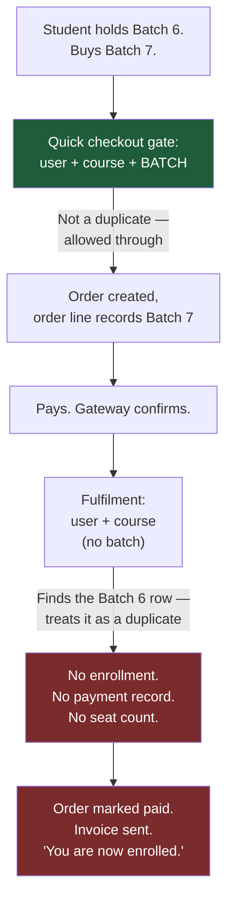
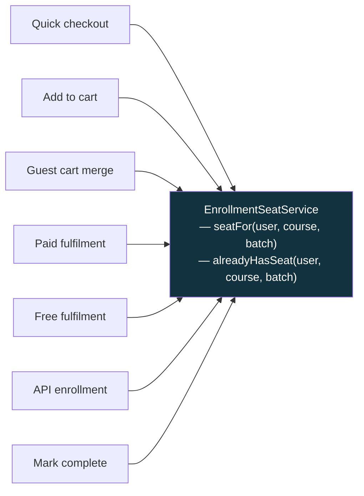
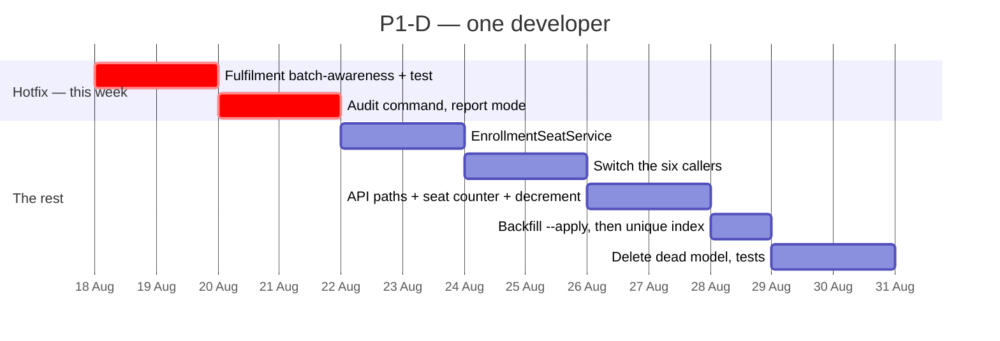

# P1-D — Data Integrity: One Seat, One Batch

**Parent plan:** [Student Experience — Analysis & Enhancement Plan](STUDENT_UX_ENHANCEMENT_PLAN.md) §3.8, §4.3
**Siblings:** [P1-A](P1A_RECORDING_PROGRESS_PLAN.md) · [P1-C](P1C_WELCOME_CHECKLIST_PLAN.md)
**Scope:** The website and the API. One course, sold by batch enrollment.
**Date:** 17 August 2026
**Status:** Build plan — **§2.1 is a live defect and needs a decision this week**
**Audience:** §1–§3 for founders and support; §4 onward for engineering
**Blocks:** Nothing formally. In practice every batch-scoped feature after it inherits what it does not fix.

---

## 1. Read this part first

The parent plan rates this item **"Low (silent) student pain, Medium business impact,
P1"** and describes it as invisible clean-up. That rating was made from the outside.
Reading the code changes it.

**A student who already holds a seat in one batch, and who buys a seat in a second
batch of the same course, is charged and receives no seat.**

The order is created. The payment goes through. The order is marked paid. The invoice
is emailed. The success page says *"Payment successful! You are now enrolled in the
courses."* And no enrollment row is written, because the fulfilment step asks
"is this student already enrolled in this **course**?" and stops when the answer is yes.

Nothing in the system flags it. The student finds out when they open the dashboard and
their new batch is not there.

The rest of P1-D is genuinely the tidy-up the parent plan describes. This one item is
not, and it should not wait for a phase.

> **Who is affected.** Only repeat buyers — students taking a follow-up batch of a
> course they have already taken. That is a small group today. It is also the most
> valuable group we have, and §4.2 of the parent plan is explicit that growing it is
> the point: *"buying the follow-up course... is not an edge case."* We would be
> scaling up a flow that silently fails.

---

## 2. What the code review found

### 2.1 🔴 The paid-order fulfilment refuses to create a second seat

Every paid web order settles through one method — the code calls it *"the
authoritative enrollment trigger"* — and it opens with a duplicate check that does not
mention the batch.



**The two halves of the same purchase disagree.** The gate at the front is batch-aware
and deliberately permits the sale. The fulfilment at the back is not, and silently
discards it.

> **Technical note.** `RemotePaymentService::createEnrollmentsForCompletedOrder()`
> filters `where('user_id')->where('course_id')->first()` with no `batch_id`, and wraps
> the `Enrollment::create()`, the `Payment::create()` and the
> `Batch::increment('enrolled_count')` inside `if (! $existingEnrollment)`. So a repeat
> purchase produces an order and an order line and nothing else.
> `CheckoutController::completeFreeOrder()` has the identical pattern.
> `QuickCheckoutController` line 107 gets it right — it checks `user_id` + `course_id`
> + `batch_id` — which is precisely why the sale is allowed to reach a fulfilment step
> that then drops it.

**The good news:** the order and its line item both record the batch, so **every
affected purchase is recoverable from data we already have.** §4.3 covers finding them.

### 2.2 🔴 Three paths create enrollments with no batch at all

These are the *"few paths that still write no batch"* the parent plan mentions. They
are all in the API payment controller — free-course enrollment, the bank-transfer
auto-complete, and the card-payment success handler. None passes a `batch_id`. All
three also increment the **course's** enrolled counter rather than the **batch's**.

So every seat sold through them is born as exactly the legacy row the parent plan wants
to clean up — and it corrupts the seat count on the way (§2.4).

### 2.3 🟠 The cart blocks second-batch purchases outright

Where quick checkout permits a repeat purchase and fulfilment silently drops it, the
cart takes a third position and refuses the sale up front: *"You are already enrolled
in this course."*

Three code paths, three different answers to one question. That is the actual root
cause here — not any individual line. **There is no single definition of "already
enrolled" in the system**, so each author picked one.

| Path | Asks | Result for a repeat buyer |
|---|---|---|
| Quick checkout | user + course + batch | Sale allowed ✅ |
| API enrollment | user + course + batch | Sale allowed ✅ |
| Add to cart | user + course | **Sale refused** |
| Guest cart merge | user + course | Item silently dropped |
| Paid fulfilment | user + course | **Charged, no seat** |
| Free fulfilment | user + course | Order paid, no seat |

### 2.4 🟠 The seat counter drifts, and the gate believes it

"Batch full" is decided by the stored `batches.enrolled_count` column, not by counting
enrollments. That column is incremented by some purchase paths and not others (§2.2),
and no path decrements it on refund or cancellation.

Two consequences, in opposite directions:

- **Over-count** → a batch reports itself full and stops selling seats it still has.
- **Under-count** → a batch keeps selling past its seat limit.

There is a second, quieter version of this: the admin batch screens display a *live*
count of active enrollments, while the sales gate uses the *stored* column. **An admin
can be looking at "28 enrolled" on screen while the gate is refusing sales because the
column says 40.** Nobody would think to distrust the number in front of them.

> **Technical note.** `Batch::getIsFullAttribute()` and `getAvailableSeatsAttribute()`
> read `$this->enrolled_count`; `enrollment_state` — documented as *"the one place
> that decides whether this batch can take an enrollment"* — reads `is_full`. Meanwhile
> `Admin\BatchController` renders `active_enrollments_count`, a withCount aggregate.
> The gate and the screen have never been reading the same number.

### 2.5 🟠 "Mark complete" writes to the wrong seat

The original §3.8 item, and it is exactly as described: the endpoint resolves the
student's enrollment with `where('course_id', ...)->first()` and writes progress
against whichever row comes back first, not the batch whose page the student is on.

Worth noting the learn page immediately above it **already does this correctly** — it
resolves the enrollment from the batch in the URL, with a comment explaining why. The
completion endpoint was simply never brought in line.

This one matters more after P1-A than before it: today it misfiles lesson progress for
the handful of courses that have lessons. Once recorded-class progress exists, the same
pattern misfiles the number a certificate will eventually be issued from.

### 2.6 🟡 A dead file shadows the real Course model

`app/Models/AllModels.php` declares a second `App\Models\Course` class with its own
copy of the seat-counting logic. It is dead — PSR-4 never loads it, and nothing
requires it — but it is indexed by every search tool, and its stale copies of
`isFull()` and `incrementEnrolledCount()` read as authoritative. It cost time during
this review. Delete it.

---

## 3. One question before we start

Everything above follows from a single unanswered product question, and the code has
been guessing at it in three different ways for months.

> **Can a student buy a second batch of a course they have already taken?**

| Answer | What it means | Recommendation |
|---|---|---|
| **Yes** | Fix the four course-level checks to be batch-level. Repeat buyers become a supported, working flow. | **Recommended** |
| No | Fix the two fulfilment paths to *refuse the sale up front* rather than take the money and drop it. | Only if the business genuinely does not want this |

**Recommendation: yes.** §4.2 of the parent plan already assumes it, the enrollment
data model already supports it, and the two entry points a real customer is most likely
to use already allow it. The rest of the system just has not been told.

**Either answer is acceptable. What is not acceptable is the current state**, where the
sale is permitted and the seat is not delivered. If the answer is "no", that is a
smaller fix and it still has to happen.

---

## 4. The build

### 4.1 One rule, one place

The fix is not six patches. It is one definition, used six times.



Two methods. `alreadyHasSeat()` answers the gate question; `seatFor()` returns the one
enrollment a given page or endpoint should be writing to. Every caller in the table
above switches to one of them.

This is the same move the platform has already made twice and been rewarded for —
`BatchAccessService` for "which batches may I see" and `Batch::enrollment_state` for
"may this batch take an enrollment". Both have comments explaining that a single brain
is what stops entry points disagreeing. This is the third such question, and it is the
one that has never been given one.

> **Technical note.** `app/Services/EnrollmentSeatService.php`. `seatFor()` resolves
> batch-first, falls back to `BatchAccessService` for a legacy batch-less row, and
> returns null rather than guessing when a course has several batches and the seat
> cannot be pinned — the same refusal `BatchAccessService` already makes.

### 4.2 Make the database enforce it

The migration that introduced `batch_id` dropped the old `(user_id, course_id)` unique
key and left a comment saying uniqueness is *"now enforced at application level"*. §2.3
is what that turned out to mean in practice.

Add a **partial unique index** on `(user_id, batch_id)` where `batch_id` is not null.
Legacy batch-less rows are unaffected; every new seat is protected by the database
rather than by six independent authors remembering to check.

This has to run **after** the backfill, not before — the index will reject duplicates
that already exist, which is the point, but it needs clean data first.

### 4.3 Find everyone it already happened to

A report-first console command, matching the pattern the codebase already uses for
`users:backfill-phone` and `payments:reconcile-remote`: **reports by default, writes
only with `--apply`.**

```
php artisan enrollments:audit-batches
php artisan enrollments:audit-batches --apply
```

Four things it reports:

| Finding | Source of truth | Action with `--apply` |
|---|---|---|
| **Paid order line with no matching enrollment** | `order_items` where the order is paid and no enrollment exists for that user + course + batch | **Nothing — report only.** Creating a seat for a real payment is a decision with money attached; it gets a human |
| Enrollment with no batch | `order_items.batch_id`, then single-batch inference | Set `batch_id` |
| Enrollment with no batch and no recoverable source | — | Report and leave alone. Guessing is what leaked one batch's classes into another |
| Seat count drift | Live count of active enrollments vs `batches.enrolled_count` | Correct the column |

The first row is the one that matters most and the one that must **not** self-heal.
Someone was charged; a human should look at each case, confirm the payment, and place
the seat. The command's job is to make sure none of them stay invisible.

### 4.4 The rest

- Point `markLessonComplete()` at `seatFor()`, resolving the batch from the request the
  same way the learn page already does (§2.5).
- Pass the batch through the three API payment paths, and increment the **batch**
  counter, not the course counter (§2.2).
- Delete `app/Models/AllModels.php` (§2.6).
- Decrement the seat count when an enrollment is refunded or cancelled, so the drift
  fixed in §4.3 does not immediately start accumulating again.

---

## 5. Sequencing



**Split into two pieces, because they have different urgency.**

**The hotfix — four days, starting now.** Make the two fulfilment paths batch-aware, and
run the audit command in report mode to find out whether this has already happened and
to whom. Four days is not a phase; it is this week. It does not need the service layer,
the index or any of the tidy-up to be useful, and every day it waits is another day a
repeat buyer can be charged for nothing.

**The rest — about nine days**, and it can run on the parent plan's Phase 1 schedule
wherever it fits.

That is roughly **thirteen days total against the parent plan's three.** The three-day
estimate was for the clean-up described in §3.8, and that part is about right. The
extra ten days are the defect the clean-up was sitting on top of.

> **Where this leaves Phase 1.** With P1-A at ~12 days and P1-C at ~9, Phase 1 for one
> developer is about **seven weeks**, not the three the parent roadmap's gantt implies.
> Three developers could bring it close to three weeks — these items genuinely share
> almost no code. That is a resourcing decision, not an engineering one, but it should
> be made deliberately rather than discovered in October.

---

## 6. How we will know it worked

| Check | Where | Passes when |
|---|---|---|
| A repeat buyer gets their seat | New `RepeatBatchPurchaseTest` | Holding Batch 6, paying for Batch 7 produces a Batch 7 enrollment, a payment record and an incremented Batch 7 count |
| The free path too | Same test, free order | Same result |
| The cart stops refusing | New test | A second batch of a held course can be added to the cart |
| The API writes a batch | New test | All three API payment paths produce an enrollment carrying a batch |
| Progress lands on the right seat | New test | Marking complete on the Batch 7 page writes against the Batch 7 enrollment |
| Duplicates are impossible | Migration + test | A second insert for the same (user, batch) is rejected by the database |
| The counter matches reality | Audit command | Reports zero drift after `--apply`, and still zero a week later |
| Nobody is left stranded | Audit report, week 1 | Every paid-but-seatless order line has been reviewed by a human and resolved |
| Nothing regressed | `BatchVideoAccessTest`, `BatchEnrollmentWindowTest`, `LiveClassBatchIsolationTest` | Still green |

The eighth row is not an engineering check. It is the one with a customer on the other
end of it, and it needs an owner in support.

---

## 7. What P1-D does not include

- **No refunds or credits.** If the audit finds affected students, what we do for them
  is a business decision, not a migration.
- **No automatic seat creation from a paid order.** Report only, by design (§4.3).
- **No change to who may see what.** `BatchAccessService` is correct and is not touched.
- **No student-visible change whatsoever.** Except for repeat buyers, who start
  receiving what they paid for.
- **No deletion of legacy batch-less enrollments.** They are backfilled where their
  batch is recoverable and left alone where it is not.

---

## 8. Risks

| Risk | Likelihood | Handling |
|---|---|---|
| The audit finds affected students and there is no plan for them | **Medium** | Run the report in week one, before deciding anything else. Better to know the number than to guess it |
| The backfill assigns a legacy row to the wrong batch | Low | Only `order_items.batch_id` and single-batch inference are trusted; anything ambiguous is reported, never guessed. `--apply` is opt-in and the run is logged |
| The unique index fails to apply because duplicates exist | Medium | That is the index doing its job. Backfill and resolve first, index second — the sequence in §5 |
| Touching payment fulfilment breaks working purchases | **Medium — this is money code** | The change is a widened `where` clause and moving three statements out of an `if`. Tests for the normal single-batch purchase come first, before the repeat-buyer case |
| Seat-count correction changes what is on sale | Low | The command reports the before and after per batch. An over-counting batch reopening for sales is the correct outcome, but someone should see it coming |
| The one-rule refactor turns into a rewrite | Medium | Two methods, seven callers, no behaviour change beyond batch-awareness. Anything larger is a different piece of work |

---

## 9. Recommended decision

**Split it. Ship the hotfix this week; schedule the rest.**

The parent plan was right that this work removes a workaround every later feature would
inherit, and right to include it in Phase 1. It was wrong about the severity, through no
fault of its own — the defect only shows up when you read the fulfilment path and the
checkout gate side by side and notice they ask different questions.

Two things are needed from outside engineering:

1. **The §3 answer** — can a student buy a second batch of the same course? Recommended
   answer: yes.
2. **An owner for the audit report** — someone in support who will work through any
   paid-but-seatless orders it turns up.

Neither blocks starting. The fulfilment fix is correct under either answer to question 1,
because taking payment and delivering nothing is not one of the options.

---

*Series so far: [P1-A](P1A_RECORDING_PROGRESS_PLAN.md) · [P1-C](P1C_WELCOME_CHECKLIST_PLAN.md) · P1-D (this document).
Phase 1 is now fully planned. Next would be **P1-B, the honest dashboard tiles** — the
small piece that reads from P1-A and is the first thing a student actually sees change.*
