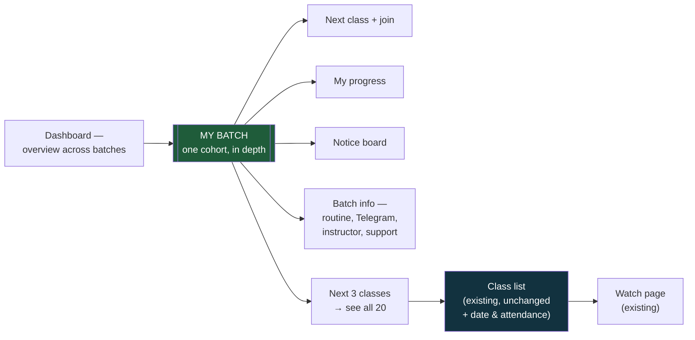
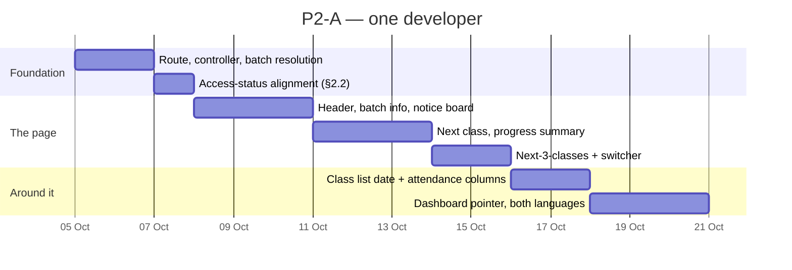

# P2-A — The My Batch Page

**Parent plan:** [Student Experience — Analysis & Enhancement Plan](STUDENT_UX_ENHANCEMENT_PLAN.md) §3.2, §4.2, §4.4
**Phase 1 siblings:** [P1-A](P1A_RECORDING_PROGRESS_PLAN.md) · [P1-B](P1B_DASHBOARD_TILES_PLAN.md) · [P1-C](P1C_WELCOME_CHECKLIST_PLAN.md) · [P1-D](P1D_DATA_INTEGRITY_PLAN.md)
**Scope:** The website. One course, sold by batch enrollment.
**Date:** 17 August 2026
**Status:** Build plan — **§3 is the decision, and it is an architectural one**
**Depends on:** P1-A (progress), P1-D (seat resolution). Reads P1-B's attendance summariser.

---

## 1. What we are building

The parent plan's §3.2: there is no single place that means *"my batch"*. A student
answers "when is my next class?" on the dashboard, "what is the routine?" in a dialog
behind one tile, "where is Telegram?" behind another, "where are the recordings?"
behind a third — and "who is my instructor, when does my batch end, how many classes
are left?" nowhere at all.

My Batch is one page that answers all of them, and becomes the daily destination.

**This is the largest single item in the parent plan.** It is also the first that adds
a destination rather than repairing one, which makes it the first where we can get the
shape wrong rather than just the numbers.

---

## 2. What the code review found

### 2.1 🔴 A batch page substantially exists already

This is the finding that should shape the whole item.

The learn page has two modes. For a course with modules and lessons it renders the
familiar sidebar-and-player layout. For a **batch course** — no lessons, only recorded
classes — it takes a completely different branch and renders a purpose-built,
full-screen class list: the course title with the batch named beside it, a pinned
welcome clip, and one row per class carrying its video and its handouts.

It is deliberate, and it is good. Its own source explains the reasoning: the page does
not scroll, so a student working through forty classes never scrolls the video they are
watching off screen; the list is the page's job and everything else is an aside.

**So the "CLASSES" section in the parent plan's My Batch sketch — *one row per class:
date, attended?, recording, handout* — is roughly 80% a description of a screen that
already ships.** The two genuinely new columns are the date and the attendance mark.

If P2-A is built as drawn, we will have two pages listing the same classes, and the
question "where do I go to watch class 6?" will have two answers where it currently has
one. The parent plan's risk table anticipates My Batch duplicating the *dashboard*. The
larger overlap is with the learn page, and it is not mentioned.

> **Technical note.** `Learn.jsx` branches on `course.is_recorded_only` — set when a
> course has no module lessons but does have published batch videos — and renders
> `LearnClassList.jsx` instead of the sidebar layout. It already handles a student in
> several batches by rendering one titled section per batch.

### 2.2 🟠 Four surfaces, three different answers to "who may see batch content"

The parent plan's §5.3 draws the access rule as settled: hold an enrollment for this
batch, and have it be `active` or `completed`. The model states that intent explicitly
and explains it. In practice the codebase gives three different answers:

| Surface | Enrollment statuses accepted |
|---|---|
| `BatchActionService` — routine, Telegram, recordings tiles | `active` + `completed` ✅ matches the documented rule |
| The learn page itself — the class list | **Any status**, including refunded and cancelled |
| Watch page, Bunny token, VdoCipher OTP, handout download | **`active` only** — excludes `completed` |

The middle row is less alarming than it looks: a refunded student can load the list and
read class titles, but every asset behind it — playback, tokens, handouts — refuses
them, so nothing protected leaks. It is an inconsistency, not a breach.

The bottom row is the live defect P1-A §2.2 already covers: a student marked
`completed` loses playback.

**Why it belongs in this document:** My Batch is a new surface, and it will pick one of
these three answers. It should pick the documented one, and the learn page's missing
status filter should be brought in line while we are in the same file. Otherwise the
page that is meant to *unify* cohort life adds a fourth interpretation of who a cohort
member is.

### 2.3 🟠 The classmate count would be wrong, and may not be allowed anyway

The header in the parent plan's sketch reads *"Batch 7 · 1 Sep – 30 Nov · instructor ·
32 classmates"*.

Two problems, in order:

1. **The obvious source is unreliable.** `batches.enrolled_count` is the stored counter
   that P1-D §2.4 shows drifts in both directions — incremented by some purchase paths
   and not others, never decremented on refund. A cohort-identity feature built on a
   number that can say 40 when the batch holds 28 is worse than no number. Count active
   enrollments live instead; it is one query.
2. **We have not decided whether students may see each other at all.** §9 question 4 of
   the parent plan asks exactly this and is unanswered. A count is a much weaker
   privacy claim than a list of names, but it is not nothing.

**Recommendation:** ship the live *count* and no names. It carries most of the cohort
feeling at almost none of the privacy cost, and it does not pre-empt the answer to a
question the business has not been asked yet.

Everything else in that header is real and available today: the batch's own start and
end dates, and its own instructor — batches carry an `instructor_id` of their own, so
the page can name the person actually teaching this run rather than the course's
default.

### 2.4 🟠 "How many classes are left" needs a definition

It is one of the questions the parent plan says has no answer anywhere, and it is worth
being precise about, because two reasonable readings give different numbers:

- **Live classes remaining** — scheduled sessions in the future for this batch.
- **Recordings not yet watched** — published classes without a completed progress row.

They answer different questions ("how much of the course is left to *happen*" versus
"how much is left for *me* to do"), and a student reading a single number will assume
whichever one they had in mind.

**Recommendation: show both, labelled.** *"3 live classes remaining · 8 recordings you
have not watched."* The data for both exists once P1-A ships.

### 2.5 🟡 The multi-batch switcher has a working precedent

The parent plan is right that a student in several batches is the case today's
dashboard handles worst, and right that it is not an edge case.

It is worth knowing that the learn page already solved the routing half of this: the
canonical URL names the batch, the course-only form still works, and the controller
resolves the enrollment from the batch in the URL rather than from "the first row we
found" — with a comment saying why. My Batch should follow the same URL shape and reuse
the same resolution, which after P1-D will live in one service.

---

## 3. The decision: what happens to the learn page

Everything in §2.1 comes down to one choice, and it is worth making explicitly rather
than discovering during the build.

| | Approach | Result |
|---|---|---|
| **A** | Build My Batch as drawn; leave the learn page alone | Two pages list the same classes. Rejected |
| **B** | Grow the learn page into My Batch; `/my-batch` redirects to it | No duplication, but a deliberately non-scrolling watch-optimised layout has to absorb notices, progress and batch info. Fights its design |
| **C** | New My Batch page; move the class list out of learn entirely | Cleanest conceptually, but throws away a screen that works and forces every student to relearn where classes live |
| **D** | **New My Batch page that owns cohort *context* and links to the class list rather than reimplementing it** | **Recommended** |

**Under option D**, My Batch shows: the header, the next class with its countdown and
join button, a progress summary, the notice board, batch info — and **the next three
classes** with a *"see all 20 classes →"* link into the existing list. The class list
stays exactly where it is, keeps its watch-optimised layout, and gains the two new
columns (date, attendance mark) in place.

One page owns *"how is my cohort going"*. The other owns *"let me work through the
material"*. Neither reimplements the other, and no student has to relearn a screen they
already use.

---

## 4. Questions for the business

| # | Question | Recommendation |
|---|---|---|
| **1** | Approve option D in §3? | **Yes** — it is the difference between ~14 days and ~20, and between one class list and two |
| **2** | Do students see each other? (parent §9 q4) | **Count only, no names** — revisit once the page is live |
| **3** | Does My Batch replace the four dashboard tiles, or sit alongside them? | **Alongside for one release, then replace.** Ship the pointer first, watch whether the tiles still get used |

On question 3: the parent plan says My Batch "replaces the four dashboard tiles as the
primary destination". Removing four things students currently rely on in the same
release that introduces where they moved to is how a good change gets reported as a
regression. Ship the new page with a one-time pointer from the dashboard, leave the
tiles for a release, then remove them once the traffic has moved.

---

## 5. The build

Almost every section reads from something that already exists. **P2-A adds no new
table.**

| Section | Source | New work |
|---|---|---|
| Header — course, batch, dates, instructor | `Batch` — `start_date`, `end_date`, `instructor_id` | None; all present |
| Classmate count | Live count of active enrollments (§2.3) | One query |
| Next class + countdown + Join | `UpcomingLiveClassService` — the same source as the pinned countdown pill | None |
| My progress | `ProgressService` (P1-A) + attendance summariser (P1-B) | None |
| Notice board | `BatchNoticeService`, including its server-side read receipts | Inline it rather than putting it behind a dialog |
| Batch info — routine, Telegram | `BatchActionService` | None |
| Next 3 classes | The same query the learn page runs | Trim to 3 |
| Batch switcher | Enrollments resolved through P1-D's seat service | Small |
| Class list — date + attendance columns | `LearnClassList.jsx` | Two columns, in place |

> **Technical note.** New `MyBatchController` and `resources/js/Pages/MyBatch/Show.jsx`.
> Routes `/my-batch` and `/my-batch/{batch}` inside the existing `auth:web` +
> `EnsureEmailIsVerified` group — the public catch-all at the bottom of `web.php` is
> constrained to four named slugs and does not conflict. Batch resolution and status
> filtering go through P1-D's seat service and `Enrollment::ACCESS_STATUSES` (§2.2);
> `/my-batch` with no batch resolves to the student's single batch, or renders a
> picker.
>
> Watch the query count. The page assembles six services; each is cheap alone, and
> together they are an easy N+1 if the batch switcher loops. Assert a query-count
> ceiling in the test, as P1-B does for the dashboard.

---

## 6. Sequencing

**About sixteen days.** The parent plan says ten. Option D is what keeps it near that —
under option A, rebuilding the class list adds roughly a week and leaves us maintaining
two of them.

**P2-B, student-visible attendance, largely lands with this.** The parent plan
schedules it as a separate 4-day item after My Batch, but under option D the attendance
column goes into the class list here, and the summary number is already built in P1-B.
What remains of P2-B is the Attended / Partial / Missed distinction and the honest note
about merged reconnects — perhaps two days, not four.

### Where the roadmap now stands

| Phase | Parent estimate | Reviewed |
|---|---|---|
| Phase 1 (P1-A/B/C/D) | 22d | ~42d |
| P2-A My Batch | 10d | ~16d |
| P2-B Attendance view | 4d | ~2d (mostly absorbed above) |
| **Through Phase 2** | **36d** | **~60d — about 12 weeks for one developer** |

Phases 3 and 4 have not been reviewed against the code and are not included. The
pattern so far is that estimates roughly double once the existing code is read, which
is normal and not a criticism of the parent plan — it was written to decide *what* to
build, and it got that right.

---

## 7. How we will know it worked

| Check | Where | Passes when |
|---|---|---|
| One cohort, one page | New `MyBatchTest` | Every question in parent §3.2's table is answerable without leaving the page |
| The right batch | Same test | A student in two batches sees only the requested batch's classes, notices and Telegram link |
| Refunded students | Same test | A refunded enrollment cannot open My Batch at all — the documented rule, applied consistently (§2.2) |
| The count is live | Same test | Deliberately corrupting `batches.enrolled_count` does not change the classmate count |
| No N+1 | Query assertion | Query count does not rise with the number of batches a student holds |
| Both languages | Manual | Every string reads correctly in Bengali |
| It becomes the destination | Production, 4 weeks | My Batch overtakes the dashboard tiles as the route into batch content |
| Support load falls | Production, 8 weeks | The parent plan's target: −40% on "where is X?" tickets |

The seventh row is the real test. If students keep reaching recordings through the old
dashboard tile after a month, the page has not become the destination and the answer is
to look at why — not to delete the tile and force the traffic.

---

## 8. What P2-A does not include

- **No new table.** Everything is assembled from existing records.
- **No classmate list.** Count only, pending §4 question 2.
- **No per-class Q&A** — Phase 4.
- **No search** — Phase 4.
- **No notification centre** — P3-B. The notice board here is the batch's board only.
- **No certificates** — P3-A. The progress summary states status without promising one.
- **No removal of the dashboard tiles** in this release (§4 question 3).
- **No rebuild of the class list.** That is the entire point of option D.

---

## 9. Risks

| Risk | Likelihood | Handling |
|---|---|---|
| Two pages end up listing the same classes | **High under option A** | Option D. It is the main decision in this document |
| The page becomes a dumping ground | **High** | Every section answers a question from parent §3.2's table. Anything that answers no question on that list does not go on the page |
| Students keep using the old tiles | Medium | Ship a one-time pointer; measure for a release before removing anything (§4 q3) |
| It depends on four Phase 1 items landing first | Medium | Progress and attendance degrade to "not tracked yet" rather than to zero. The page is worth having without them |
| Query count balloons | Medium | Six services on one page. Ceiling asserted in tests |
| The classmate count exposes something we did not intend | Low | Count only, no names, no avatars, no activity |

---

## 10. Recommended decision

**Proceed — after Phase 1, and under option D.**

The parent plan is right that this page is the answer to §3.2, and right that it should
follow Phase 1 rather than lead it: nearly every section reads from something Phase 1
produces, and building it first means building the numbers twice.

The one thing to decide before anyone starts is §3. The parent plan's sketch describes a
class list that already exists and works well, and the difference between reusing it and
rebuilding it is about a week of work now and a duplicated screen forever.

What we need from the business is §4 — and really only question 1.

---

*Series: [P1-A](P1A_RECORDING_PROGRESS_PLAN.md) · [P1-B](P1B_DASHBOARD_TILES_PLAN.md) ·
[P1-C](P1C_WELCOME_CHECKLIST_PLAN.md) · [P1-D](P1D_DATA_INTEGRITY_PLAN.md) ·
P2-A (this document).
Phase 2 finishes with **P2-B, student-visible attendance** — now largely absorbed into
this item, and worth re-scoping before it is scheduled.*
