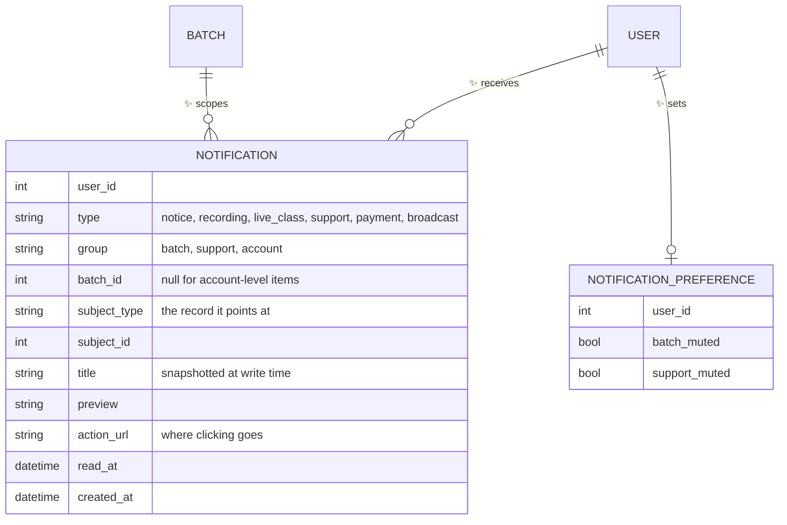
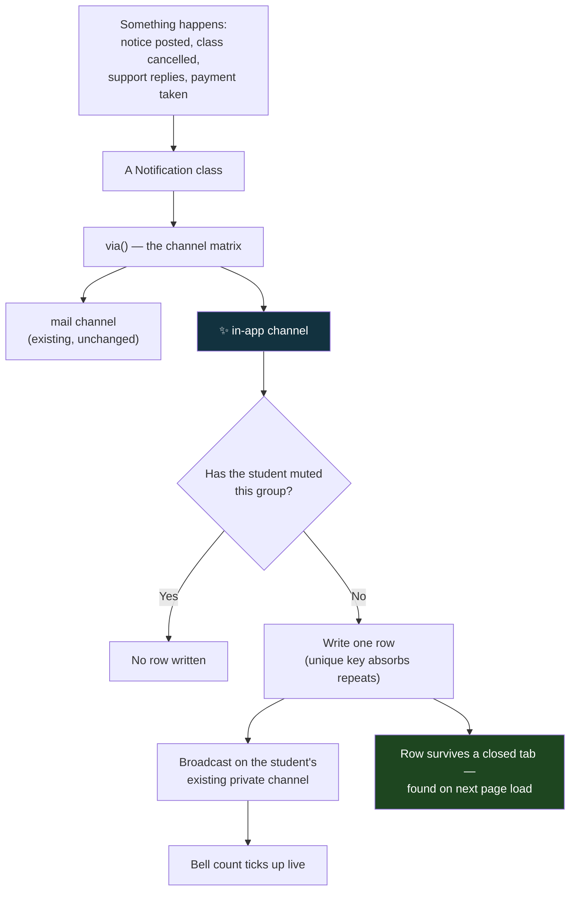
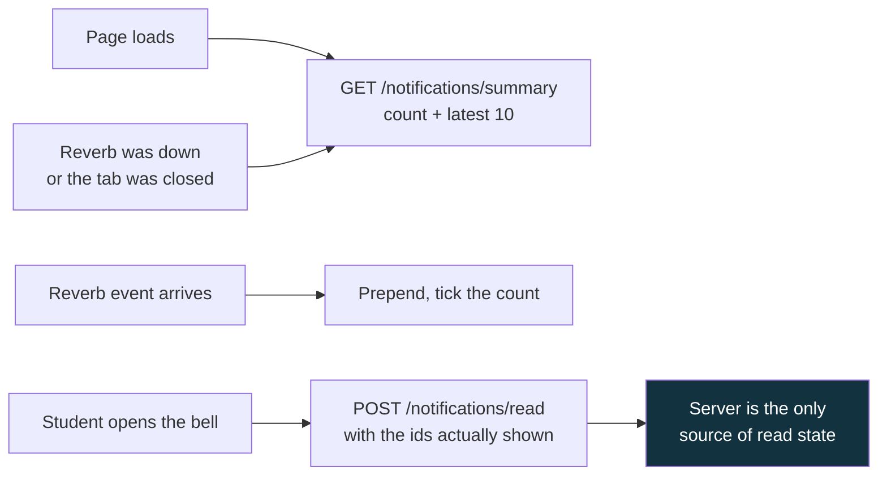
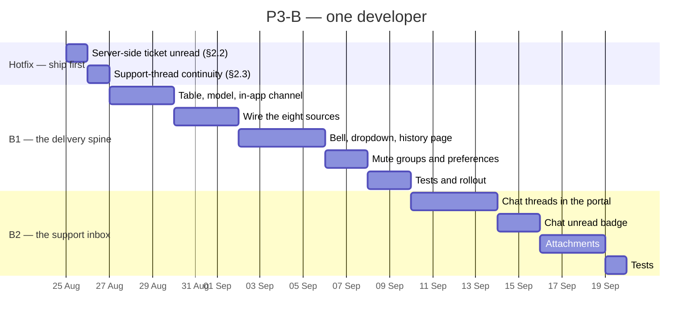

# P3-B — The Notification Centre and the Support Inbox

**Parent plan:** [Student Experience — Analysis & Enhancement Plan](STUDENT_UX_ENHANCEMENT_PLAN.md) §3.5, §4.4
**Scope:** The website only. One course, sold by batch enrollment.
**Date:** 18 August 2026
**Status:** Build plan — ready for a go/no-go decision on §3
**Audience:** Founders, product and support for §1–§3, engineering for §4 onward
**Depends on:** Nothing. Every source of a notification already exists today.
**Blocked by:** Nothing. §5 proposes pulling two items forward as a hotfix.

---

## How to read this document

§1–§3 are the decision. They say what the student gets, what we found in the code
that the parent plan did not know, and the five questions that need an answer before
anyone writes code. **If you read nothing else, read §2.1 and §3.**

§4 onward is the build and can be skipped by non-technical readers entirely.

This document covers **two things that the parent plan listed separately**, and §2.2
explains why they turned out to be one piece of work: the notification centre (§3.5 of
the parent plan) and the support experience it feeds. They share a single mechanism —
a durable record of "this happened to you, and whether you have seen it" — and building
either one without the other means building that mechanism twice.

---

## 1. What we are building

Today, when something happens to a student, the platform's only reliable way to tell
them is email. Everything else is a message shouted into a room they are probably not
standing in.

After P3-B:

| | Today | After P3-B |
|---|---|---|
| Support replies to your ticket | An email, plus a toast **only if your tab happens to be open** | A bell with a count, waiting for you whenever you come back |
| Support replies to your chat | Nothing at all, unless the widget is open | Same bell, same count |
| A notice is posted to your batch | You find it next time you open the dashboard | The bell tells you |
| A class is cancelled or moved | An email | An email *and* the bell |
| "Have I read this already?" | Answered by your browser — so a reply read on your phone is still bold on your laptop | Answered by the server, once, everywhere |
| Finding a conversation you had last week | Chat is in the floating widget, tickets are at `/support`, and neither knows about the other | One list, both kinds of thread |
| Sending a screenshot of a failed payment | Not possible | Attach it to the ticket |

**The bell is an index, not a second copy.** Every item in it is a link to the place the
thing actually lives — the notice board, the ticket, the live class. Nothing is
duplicated, and nothing in the bell can disagree with the page it points at.

---

## 2. What the code review changed

The parent plan sized this at eight days for a bell in the header. The bell is the
easy part. Seven things found in the application repository change the shape of the
work — two of them are live defects that students are hitting today.

### 2.1 🟢 The hard half is already built — and this is the main finding

This is unusual enough to lead with, because it changes the cost of the whole phase.

A notification centre needs four things: a live transport, an authenticated per-user
channel, a client that can react to an arriving event, and a durable record behind it.
**We have the first three in production right now.**

| Piece | Status today |
|---|---|
| WebSocket transport | Laravel Reverb, running in production |
| A private per-student channel | `App.Models.User.{id}`, authorised in `routes/channels.php` |
| A client listening on it from every page | `useCustomerSupportRealtime`, mounted in `AppLayout` |
| Chime, toast and click-through-to-destination | Built, working |
| A durable record | **Missing. This is the entire gap.** |

When support answers a student today, the answer reaches their browser in milliseconds
and is rendered as a toast. If their tab is closed — which it is, most of the time —
that event is **destroyed**. Reverb does not replay. There is no row anywhere saying
it happened.

So P3-B is not "build a notification system". It is "put a table behind the
notification system we already run". That is a materially cheaper job than the parent
plan assumed, and it is why §5 recommends a shorter spine phase than eight days.

> **Technical note.** `resources/js/hooks/useCustomerSupportRealtime.js` subscribes to
> the customer's private channel and handles `.support.reply`, dispatched by
> `App\Events\SupportReplyReceived` (a `ShouldBroadcastNow` event) from both
> `Admin\SupportChatController` and `Admin\SupportTicketsController`. The payload is
> already the right shape for a notification row — `kind`, `ref_id`, `title`,
> `preview`, `url`, `occurred_at`. Persisting it is close to a one-line change at the
> dispatch site.
>
> One inconsistency to clear up while we are in there: that hook's comment claims
> "Reverb replays events on reconnect". It does not, and the admin-side
> `SupportCatchUpController` docblock — written later, in response to a real
> "notifications are late" report — says so explicitly and correctly. The hook's
> dedupe set is still worth keeping, but the comment above it is wrong and has
> probably shaped somebody's mental model of what happens after a dropped connection.

### 2.2 🔴 The support portal's unread badge is computed by the browser

**The defect.** `/support` decides which tickets are unread by reading a
`support_seen` key out of `localStorage`. Read a support reply on your phone, open
your laptop, and the ticket is bold and unread again. Clear your browser data and
every ticket you have ever had is unread.

**What makes this worth calling a defect rather than a rough edge:** the server
already stores the correct answer and the portal ignores it. `ticket_replies.read_at`
exists, is indexed, and is stamped the moment a student opens a thread. The platform
knows. It just does not ask.

This is also the exact pattern the team already fixed once, deliberately, for the
notice board — `batch_notice_reads` was created precisely so that "a notice read on a
phone is not unread on a laptop", and the parent plan lists that as one of the six
things that already work and must not be broken. The support portal predates that
decision and never caught up.

> **Technical note.** `resources/js/Pages/Support/Index.jsx` lines 38–46 and 218–223.
> Migration `2026_07_23_100000_add_delivery_tracking_to_support_replies` added
> `ticket_replies.read_at` with a `(ticket_id, read_at)` index; `SupportController::getTicket()`
> stamps it. No endpoint exposes the resulting count, which is why the client invented
> its own. One `unread_count` on the ticket payload retires the localStorage store
> entirely.

### 2.3 🔴 An open support chat is tied to one browser

**The defect.** A student escalates from the AI assistant to a human, gets no answer
before bed, and opens the site on their phone the next morning. The support thread is
not there. The agent's reply is sitting in a conversation the student can no longer
reach.

**Why.** The widget remembers which conversation it is in via a `chat_conversation_id`
key in `localStorage`. When the widget boots, `GET /chat` resolves the student's
**chatbot** conversation from the server — but never their **support** conversation.
So the server knows the thread exists and the widget does not ask for it.

The fix is small and the server-side lookup is already written: the same
`findOrCreateSupportConversation` used when a student clicks "talk to a human" finds an
existing `pending` or `active` support thread by `user_id`. The bootstrap simply does
not call it.

**Compounding it:** the chat launcher has **no unread badge of any kind**. Even on the
same device, a student who closes the widget has nothing telling them an agent replied.

> **Technical note.** `ChatController::index()` does `firstOrCreate` on
> `['user_id', 'type' => 'chatbot']` only. `ChatWidget.jsx` restores from
> `localStorage` (line 351) and only marks messages read while `isOpenRef.current` is
> true. `chat_messages` already carries `is_read` and `read_at`, so the unread count
> is a `where` clause, not a schema change.

### 2.4 🟠 Chat and tickets are two support products that cannot see each other

`/support` is a ticket portal. Chat conversations never appear in it. A student who
asked a question in the widget on Monday has no route back to that conversation from
the support page on Wednesday — and no way to tell whether their question became a
ticket, stayed a chat, or was answered somewhere they are not looking.

From the student's side there is one question — "where did I ask this, and did anyone
answer?" — and the product answers it in two places that do not link to each other.

The good news is that the portal's own structure does not resist the fix: its sidebar
is already a generic list of threads with status chips, a search box, previews and
timestamps. It needs a second source, not a rewrite.

### 2.5 🟠 Tickets cannot carry a screenshot

`ticket_replies` has no attachment column and the portal has no upload control. The
single most common support case on a payment platform — "my payment failed, here is
what I saw" — cannot be expressed. Agents ask students to describe an error message
from memory, or the conversation moves to Telegram and out of the record entirely.

Note that the platform already has attachment infrastructure: admin broadcasts store
files through `student_message_attachments`, and handouts go to Bunny CDN and are
served back through an access-checked route. This is applying an existing pattern, not
inventing one.

### 2.6 🟠 Every notification the platform sends is email, and none of it is optional

All eleven notification classes in `app/Notifications/` return `['mail']` from `via()`.
There is no in-app channel, no SMS for anything but OTP and broadcasts, and no user
preference table anywhere.

Adding a bell without deciding the channel matrix produces the obvious bad outcome: a
student gets an email *and* a bell item for the same event, and concludes that both
are noise. **§3, question 1 is that decision**, and §4.2 puts it in one place in the
code so it cannot drift.

### 2.7 🟡 A batch notice to 300 students must not be written inside the admin's request

Most notifications are one row for one student. Two are not: a batch notice and an
admin broadcast fan out to the whole cohort.

This platform has been bitten by exactly this before. The mail throttling work in
August exists because a bulk send saturated a shared worker pool. Fan-out here is
cheaper — database rows, not SMTP — but it belongs in a queued, chunked job on the
`default` queue, never inline in the request that created the notice.

### 2.8 🟡 The bell must obey batch access, like everything else

A notification title can carry batch content: *"Batch 7 — Friday's class moved to
9pm."* A student whose enrollment was refunded should stop seeing that, the same way
they stop seeing the notice board, the recordings and the Telegram link.

**Rule adopted:** batch-scoped notifications are filtered through `BatchAccessService`
at read time, not at write time. Access is a live question, and answering it when the
row is written would freeze the answer as it was that day.

---

## 3. Five questions before we start

Engineering can begin on §4.1 today. These five gate everything after it.

| # | Question | Recommendation | Why it matters |
|---|---|---|---|
| **1** | Does an in-app notification replace the email for the same event? | **No — one matrix, decided per type** (see §4.2) | Money and access events keep their email: it is the record a student forwards to their bank or shows to support. Batch notices and new recordings become bell-only, because those are exactly the emails people mute. |
| **2** | Do students get mute controls in v1? | **Yes, but three groups, not per type** | "Batch activity", "Support", "Account and payments" — with the last one not mutable. Per-type switches are a settings page nobody reads and a support burden when someone mutes the thing they later say they never received. |
| **3** | Do chat conversations join the ticket portal? | **Yes** | §2.4. Half the value of this phase is that a student stops having to remember *where* they asked. |
| **4** | How long do notifications live? | **Read: 90 days. Unread: never auto-pruned** | Deleting something a student has not seen is the one behaviour that would make the bell untrustworthy. A nightly prune on read rows keeps the table small. |
| **5** | Do the two defects in §2.2 and §2.3 wait for this phase? | **No — ship them as a hotfix now** | They are live today, they are small, and they need none of this phase's new tables. P1-D set the precedent for shipping a hotfix ahead of its phase. |

> Question 1 is the one worth a real conversation. The rest are written here mainly so
> nobody has to re-derive them in a standup.

---

## 4. The build

### 4.1 Data

One new table, plus one small table for preferences.

**Three decisions inside that table worth stating plainly:**

1. **The title is snapshotted, the destination is not.** A notification stores the
   words as they were when it was written, so renaming a live class next month does not
   rewrite last month's history. But `action_url` is followed live, and the page at the
   other end does its own access check — so a notification can never become a way in.
2. **`subject_type` + `subject_id` make duplicates impossible at the database level.**
   A unique index on (`user_id`, `type`, `subject_type`, `subject_id`) means the
   one-hour live-class reminder can be attempted twice by two schedulers and still
   produce one row. The alternative — remembering not to send twice — is the kind of
   thing that works until a deploy restarts a worker mid-run.
3. **`group` exists so muting is coarse.** It is the column question 2 in §3 is about.

> **Technical note.** Migration `create_notifications_table` — a project table, not
> Laravel's default `notifications` table. The default stores everything in a JSON
> `data` column with a UUID key, which makes the unique index in point 2 an expression
> index and makes "unread count by group" an unindexed scan. Indexes on
> (`user_id`, `read_at`) and (`user_id`, `created_at` desc), foreign keys cascading on
> delete, `subject` as a nullable morph.
>
> We still use Laravel's notification machinery — see §4.2 — so this is a custom
> **channel**, not a rejection of the framework's system.

### 4.2 One place that decides who hears about what

The point of routing through `via()` rather than writing rows at each dispatch site is
that **one file per event type decides both channels**. Question 1 in §3 then has
exactly one place it is expressed, and a future change — "stop emailing about
recordings" — is a one-line edit, not a hunt.

The green box is the whole feature. Everything else on this diagram exists today.

**The channel matrix as recommended:**

| Event | Email | Bell | SMS | Dispatch point today |
|---|---|---|---|---|
| Payment received / invoice | ✅ | ✅ | – | `OrderInvoiceNotification` |
| Live class starting in 1 hour | ✅ | ✅ | – | `LiveClassReminder` |
| Live class cancelled or moved | ✅ | ✅ | – | `LiveClassCancelled` |
| Support replied — ticket or chat | ✅ | ✅ | – | `SupportReplyReceived` |
| Admin broadcast | ✅ | ✅ | ✅ | `StudentMessageService` |
| Batch notice posted | – | ✅ | – | `Admin\BatchNoticeController` |
| New recording published | – | ✅ | – | **needs a hook** |
| Progress milestone (P1-A / P3-A) | – | ✅ | – | later, additive |

Seven of the eight already have a dispatch point in the code. Only "new recording
published" needs a new hook, and it sits in `Admin\BatchVideoController` where the
publish already happens.

### 4.3 Reading, and why catch-up is trivial here

The admin dashboard needed a purpose-built catch-up endpoint that walks five source
tables with a cursor of row ids, because nothing on that side is persisted either.
**The student side does not need that**, and the reason is worth stating: once the row
exists, the table *is* the catch-up. A page load asks one question.

Losing Reverb entirely degrades this to "notifications appear on next page load".
That is a good failure mode, and it is only available because the row is written
first and broadcast second.

> **Technical note.** New `app/Http/Controllers/NotificationController.php` —
> `summary` (count plus the latest ten), `index` (the full page, paginated), `read`
> (mark specific ids), `readAll`. The read endpoint mirrors `BatchNoticeReadController`
> deliberately, including posting the ids actually seen rather than marking everything
> on open, so "unread" keeps meaning something after the first visit. Batch-scoped rows
> are filtered through `BatchAccessService` on read, per §2.8. `Realtime::emit` already
> swallows a dead Reverb without failing the request that triggered it, so nothing new
> is needed for that path.

### 4.4 What changes on screen

**The bell** — `Header.jsx`, desktop nav and mobile menu. A count, a dropdown of the
latest ten grouped by day, "mark all read", and a link to `/notifications` for the
full history. One list, not tabs: five tabs on a stream that will average two items a
day is a filing system for a shoebox.

**The support inbox** — `/support` gains chat conversations alongside tickets in the
existing sidebar, distinguished by a small kind chip rather than a separate pane. The
unread dot comes from the server. The localStorage store is deleted, not supplemented.

**The chat widget** — an unread badge on the closed launcher; the bootstrap resolves an
open support thread so it follows the student between devices.

**Attachments** — on ticket replies and chat messages: images and PDF, size-capped,
stored on Bunny CDN and served back through an access-checked route, exactly as class
handouts already are. The public CDN link never reaches the browser.

| Where | Change | Size |
|---|---|---|
| `Header.jsx` | Bell, count, dropdown | M |
| `Pages/Notifications/Index.jsx` | New page — full history | S |
| `Pages/Support/Index.jsx` | Server-side unread; chat threads in the list | M |
| `Components/ChatWidget.jsx` | Launcher badge; support-thread bootstrap | S |
| `Support/Components/*` | Attachment upload and rendering | M |
| `AppLayout.jsx` | The existing hook also updates the bell | S |

---

## 5. Sequencing

Two pieces, and a hotfix that should not wait for either.

**B1 is roughly three weeks; B2 roughly two.** Against the parent plan's eight days —
but the parent plan's eight days covered the bell alone and did not size the support
work at all. Compared like for like, B1 is fourteen days against eight, and the
overrun is almost entirely §4.2: the channel matrix and the mute groups are real work
that "a bell in the header" does not suggest.

**Two things could reorder this phase, and both are the business's call:**

1. **The hotfix should go this week regardless.** Two days, no new tables, fixes
   behaviour students are hitting now.
2. **B1 does not depend on Phase 1 or Phase 2.** The parent plan schedules P3-B after
   attendance, but nothing in the delivery spine reads progress data — its eight
   sources all exist today. If the calendar allows, B1 can run in parallel with
   Phase 2 rather than after it, and P1-A's and P3-A's notification types then plug
   into a bell that already exists. Adding a type later is one file.

---

## 6. How we will know it worked

| Check | Where | Passes when |
|---|---|---|
| Nothing is lost to a closed tab | New `NotificationDeliveryTest` | A support reply written while the student has no session produces a row they see on next login |
| No duplicates | New test | Firing the same live-class reminder twice produces one row |
| Read state is server-side | New test | Marking read in one session shows read in another; no `localStorage` key remains in `Pages/Support` |
| Access is respected | Extend `BatchNoticeTest` pattern | A refunded student's batch notifications disappear from the bell |
| Fan-out is bounded | New test | A notice to a 300-student batch enqueues a chunked job and does not write in-request |
| Muting works | New test | A muted group writes no row and sends no mail for bell-only types |
| Students actually use it | Production, week 2 | Median time from a support reply being written to a student reading it — today effectively unbounded for anyone with the tab closed |
| The bell does not become noise | Production, week 4 | Mute rate below 10%, and unread count reaching zero for most active students within 48 hours |

The last two are the ones that decide whether this feature was worth building. A bell
that everyone mutes in month two is a more expensive outcome than no bell, because it
also trains students to ignore the batch notices we route through it.

---

## 7. What P3-B explicitly does not include

Stated so that scope creep has to be an argument rather than an assumption:

- **No push notifications.** Browser push and mobile push are a separate decision with
  their own permissions story. The bell is in-app only.
- **No digest emails.** "Your week in Batch 7" is a marketing product, not this.
- **No per-class Q&A.** That is P4-A, and the temptation to make chat threads carry it
  should be resisted — it needs to be public to the batch, which support threads are not.
- **No ticket categories, CSAT ratings or canned replies.** All reasonable, none of them
  what a student is missing today.
- **No changes to the AI assistant's behaviour.** It keeps escalating exactly as it does.
- **No mobile app.** The `/api` surface is unchanged; the app keeps behaving as it does.
  A future app notification screen reads the same table.
- **No backfill.** The bell starts empty on the day it ships. Unlike progress tracking,
  nobody expects notification history to exist retroactively.

---

## 8. Risks

| Risk | Likelihood | Handling |
|---|---|---|
| The bell becomes noise and gets muted | Medium | Eight types at launch, three mute groups, and a hard rule that a new type needs evidence. Tracked as a success metric in §6, not assumed away |
| Email and bell duplicate each other | **High if not planned for** | The single channel matrix in §4.2, expressed in `via()` and nowhere else |
| Batch fan-out inside an admin request | Medium | §2.7 — a queued chunked job, with a test that asserts it |
| A refunded student keeps seeing batch content | Low | Read-time filtering through `BatchAccessService` (§2.8) |
| Reverb outage looks like a broken feature | Low | Persist first, broadcast second. An outage delays a notification to the next page load; it never loses one |
| The support portal rewrite grows | Medium | B2 adds a source to an existing list. If it starts becoming a new page, it has left scope |
| Attachments become a file-hosting product | Low | Images and PDF only, size-capped, same access-checked route as handouts |
| The hotfix gets absorbed into the phase and slips | Medium | §3 question 5 — it ships separately or the two live defects stay live for a month |

---

## 9. Recommended decision

**Proceed. Ship the hotfix this week, then B1, then B2.**

The review changed the economics of this phase in both directions. It is cheaper than
the parent plan assumed, because the transport, the authenticated channel, the client
listener and the chime all already exist and work — what is missing is a table. And it
is larger, because the parent plan counted the bell and not the two live support
defects sitting underneath it, or the channel matrix that stops the bell from becoming
another muted inbox.

The strongest argument for doing it at all is the one in §2.1: we are already sending
these notifications. We send them into a room the student is usually not standing in,
and then we destroy them. Every part of that pipeline is built except the part that
remembers.

What we need from the business is §3 — and really only questions 1 and 5.

---

*Related documents: [P1-A](P1A_RECORDING_PROGRESS_PLAN.md) supplies the progress
milestone notification type; [P2-A](P2A_MY_BATCH_PAGE_PLAN.md) is where a batch-scoped
subset of this stream may eventually surface alongside the notice board.*
