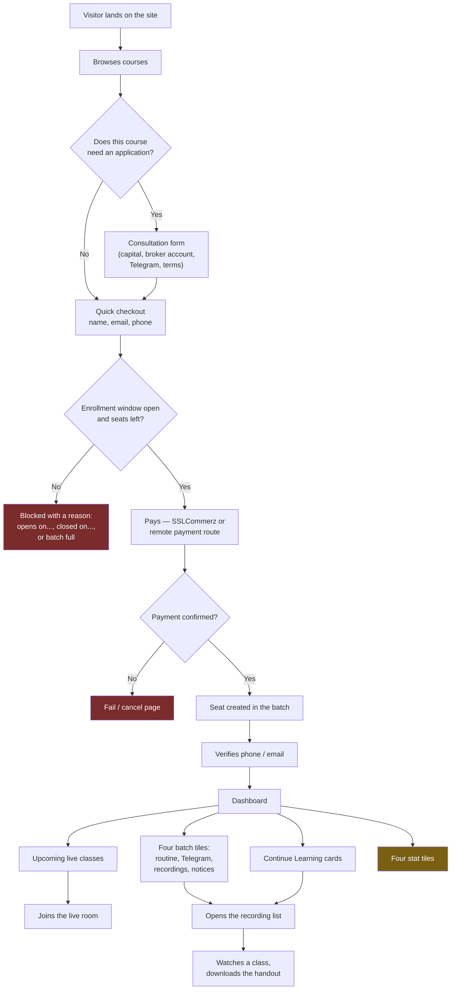
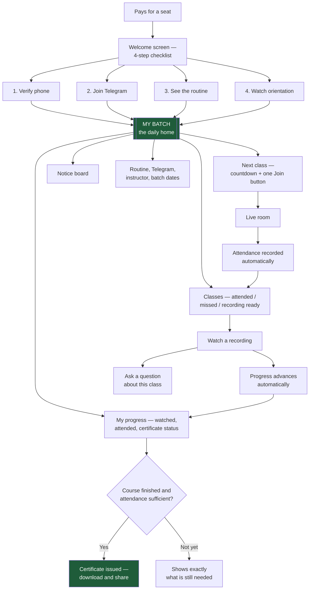
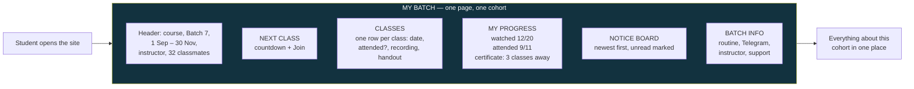
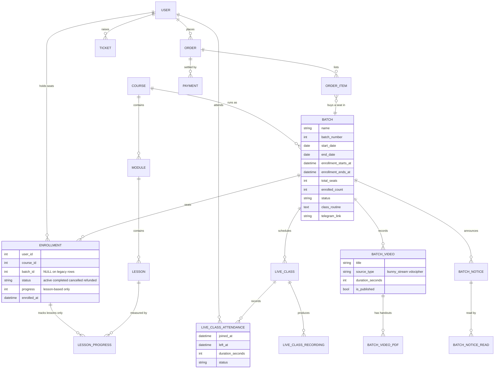
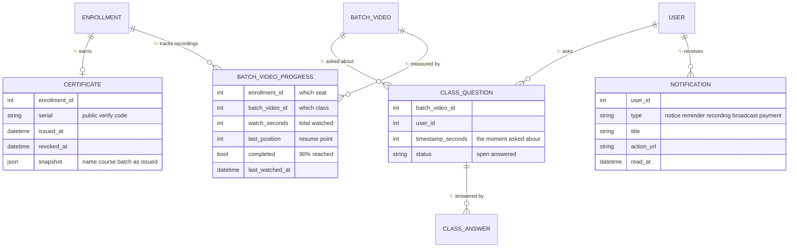
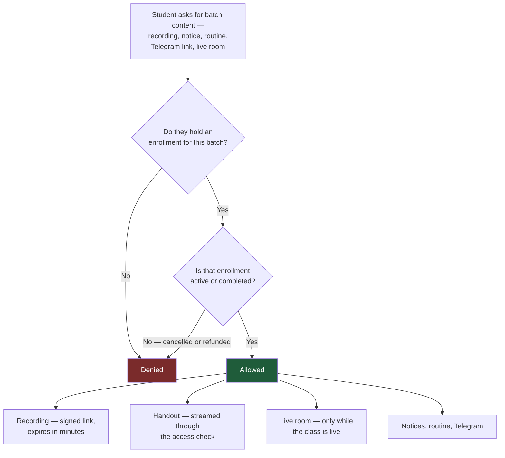
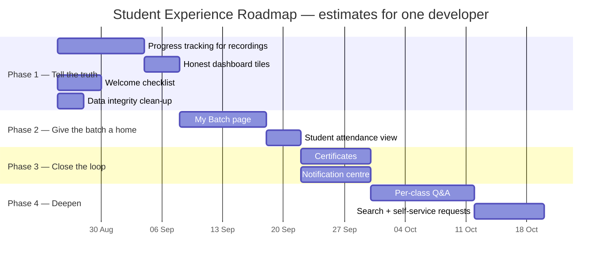

# Student Experience — Analysis & Enhancement Plan

**Product:** Trading Chart learning platform
**Scope:** The website only. The mobile app is deliberately out of scope for this plan.
**Date:** 16 August 2026
**Status:** Proposal for review — nothing here is built yet
**Audience:** Founders, product, marketing, support, engineering

---

## How to read this document

Everything here is written to be readable without a technical background. Implementation
detail sits in indented **Technical note** blocks that you can skip entirely.

Two words are used constantly:

- **Course** — the subject taught, e.g. "Advanced Price Action".
- **Batch** — one *run* of that course: its own start date, seats, students, live classes,
  recordings and Telegram group.

> **The batch — not the course — is what a student actually belongs to.** Most problems in
> this document come from places where the product forgets that.

Three kinds of diagram appear:

| Diagram | Shows | How to read it |
|---|---|---|
| **Flowchart** | Steps in order | Follow the arrows. A diamond ◇ is a decision; its outgoing arrows are labelled with the answer. |
| **ERD** | What we store and how it connects | Each box is one kind of record. Lines show how many connect to how many — `1 → many` means "one batch has many students". |
| **Timeline (Gantt)** | Build order | Left to right. Overlapping bars can run at the same time. |

---

## 1. Executive summary

**What we have.** A production website where students buy a seat in a batch, join live
classes, watch recordings, download handouts, read the batch notice board and get support.
The plumbing is genuinely good: access control, payments, live classes, video protection
and notices all work, and all of them are batch-aware.

**What is wrong.** The *plumbing* is batch-aware; the *experience* is not.

1. There is no single place that means "my batch". Cohort life is scattered across a
   dashboard tile, a learn page, a live-class list and an account page.
2. Worse, several dashboard numbers are **structurally wrong for batch students**. Progress
   always reads 0%, watch time always reads 0, and certificates can never exceed 0 — because
   all three are computed from a lesson-based model that batch courses do not use.

**The recommendation — four phases over roughly a quarter:**

| Phase | Theme | Headline outcome |
|---|---|---|
| **1** | Tell the truth | Progress, watch time and certificates stop lying. Batch videos get real progress tracking. |
| **2** | Give the batch a home | One "My Batch" page that becomes the student's daily destination. |
| **3** | Close the loop | Attendance visible to students, real certificates, in-app notification centre. |
| **4** | Deepen | Per-class Q&A, search, self-service batch requests. |

**Why it matters commercially.** Batch products live or die on *completion and renewal*. A
student who cannot see their own progress has no reason to feel invested, no milestone to
celebrate and nothing to show for finishing. Everything in Phase 1 exists to create the
feeling of forward motion — the cheapest retention lever we have.

---

## 2. What the platform does today

### 2.1 The student's journey, as it exists

The yellow box (`Four stat tiles`) is highlighted because it is the first thing a student
sees that is factually wrong for most of them — see §3.1.

### 2.2 Every screen a student can reach

| Screen | Address | What it does | Verdict |
|---|---|---|---|
| Dashboard | `/dashboard` | Live classes, batch tiles, course cards, stats | Overloaded; some numbers wrong |
| Learn / class list | `/courses/{course}/batches/{batch}/learn` | Recordings, handouts, curriculum | Solid; the real workhorse |
| Watch one class | `/courses/{course}/class/{id}` | Full-screen single recording | Good |
| Live classes | `/live-classes` | Upcoming and live sessions | Thin — no past or attendance view |
| Live room | `/live-classes/{id}/room` | The embedded classroom | Good |
| My Account | `/my-account` | Profile, password, orders, my courses | Fine, but the *only* place with history |
| Support | `/support` | Tickets and replies | Good |
| Chat widget | site-wide | AI assistant, escalates to a human | Good |
| Cart / checkout | `/cart`, `/checkout` | Buying | Good |

**What is missing from that list is the point of this document:** no page called "my batch",
no attendance record, no certificate, no notification inbox, and nowhere to ask a question
about a specific recorded class.

### 2.3 What already works — do not break these

Every proposal below builds on these rather than replacing them.

1. **Batch access control is centralised and correct.** One service decides which batches a
   student may see, and every entry point asks it. A refunded student loses the room, the
   notice board *and* the Telegram link together — they cannot fall out of sync.
2. **The enrollment gate has one brain.** Quick checkout, cart, API or chatbot — the same
   rules decide open / not-yet-open / closed / full, with the same human-readable reason.
3. **Video is properly protected.** Recordings are served through short-lived signed links
   minted per request after an access check; the underlying file address never reaches the
   browser. Handouts go through the same check.
4. **Notices have real read receipts** stored server-side, so a notice read on a phone is not
   unread on a laptop.
5. **Live classes are batch-isolated** — Batch 7 can never see Batch 6's classroom.
6. **Bengali/English translation and multi-currency** are built in throughout.

---

## 3. Where it hurts — the gap analysis

Each gap reads: *what the student experiences* → *why it happens* → *what it costs us*.

### 3.1 🔴 The progress bar is always empty — highest priority

**Experience.** A student has attended nine live classes and watched twelve recordings.
Their dashboard says **Progress 0%**, **Watch Time 0h 0m**, **Certificates 0**. Nothing they
do ever moves any of it.

**Why.** Two content models grew at different times:

- **Lesson-based courses** — modules contain lessons, and a `lesson_progress` record is
  written whenever a student watches or completes one.
- **Batch-based courses** — a batch has recorded class videos (`batch_videos`), and **there
  is no progress table for them at all.**

Every dashboard number is computed from the lesson side. Batch students have zero lesson
records, so every number is zero, permanently. The dashboard already patches one symptom —
showing "12 videos" instead of "0/0 lessons" — but progress, watch time and certificates are
untouched.

**Cost.** This is the retention problem. No momentum, no "you're 60% through", no milestone,
no reason to come back tomorrow rather than next month. It also makes the certificate tile a
promise we cannot keep.

> **Technical note.** `enrollments.progress` is computed by `Enrollment::calculateProgress()`
> from `course->lessons()`. `batch_videos` has no companion progress table and no watch-time
> column. `DashboardController::index()` sums `lessonProgress.watch_time` for watch time and
> counts `enrollments where progress >= 100` for certificates.

### 3.2 🔴 There is no "my batch" page

**Experience.** Cohort life is spread across four tiles, and the student must remember which
is which:

| Question | Where the answer lives today |
|---|---|
| When is my next class? | Dashboard |
| What is the weekly routine? | Dashboard tile → dialog |
| Where is the Telegram group? | A different dashboard tile |
| Where are the recordings? | A third tile → the Learn page |
| Was there an announcement? | A fourth tile → another dialog |
| Who is my instructor? When does my batch end? How many classes are left? | **Nowhere** |

**Why.** The dashboard was built as a general LMS dashboard, and batch features were bolted
on as tiles. The batch itself was never given a page.

**Cost.** Support load ("where is Tuesday's recording?") and a weak sense of belonging to a
cohort — which is exactly what a batch product sells.

### 3.3 🟠 Certificates are advertised but do not exist

**Experience.** A "Certificates" counter permanently stuck at 0, with no page behind it and
no explanation of how to earn one.

**Why.** There is no certificate record, template, issuing rule or verification page
anywhere in the system. The counter is a placeholder that shipped.

**Cost.** A certificate is free marketing — students post them. We show the counter, capture
none of the value, and look broken while doing it.

### 3.4 🟠 Attendance is recorded but invisible to students

**Experience.** No way to answer "which classes did I miss?" — students scroll the recording
list and guess.

**Why.** Every join and leave *is* recorded, with duration and reconnect counts, but it
feeds admin reporting only. No student-facing screen reads it.

**Cost.** A ready-made, already-collected, high-value feature sitting unused — and the best
possible input for a fair certificate rule (§4.4).

### 3.5 🟠 Announcements have no inbox

**Experience.** Announcements arrive by email or SMS. In the app only *batch notices* are
visible, and only behind a dashboard tile. Miss the email and there is no in-app history.

**Why.** Broadcasts (email/SMS campaigns) and batch notices are separate systems, and
neither has an in-app inbox with an unread badge.

**Cost.** Missed classes, missed deadlines, repeat support questions. We already run a live
WebSocket connection, so real-time delivery is nearly free.

### 3.6 🟡 Nothing happens between "payment succeeded" and "first class"

**Experience.** They pay, see a success page, then silence until the first class. Nobody
tells them to join Telegram, check the routine, verify their phone or watch an orientation.

**Why.** There is no onboarding checklist; the dashboard treats a five-minute-old student
identically to a five-week-old one.

**Cost.** The highest-anxiety, highest-refund-risk moment of the journey is left empty.
Every slowly-filling Telegram group and every "did my payment go through?" ticket starts here.

### 3.7 🟡 Questions about a recorded class have nowhere to go

**Experience.** A student is watching class 6, does not follow something at 14:20, and their
options are a general support ticket, a general AI chat, or the Telegram group where it
scrolls away within the hour.

**Cost.** Instructors answer the same question repeatedly, and the answers are never captured
where the next student would find them.

### 3.8 🟡 Two data-integrity risks worth fixing while we are in here

1. **Enrollments with no batch.** Records created before batches existed — plus a few paths
   that still write no batch — carry none. The system recovers gracefully today, but every
   new batch-scoped feature inherits that workaround.
2. **Wrong seat when a student is in two batches of the same course.** "Mark lesson complete"
   picks the student's *first* enrollment for the course rather than the one whose page they
   are on, so progress can be written against the wrong batch.

### 3.9 Gap summary, ranked

| # | Gap | Student pain | Business impact | Effort | Priority |
|---|---|---|---|---|---|
| 3.1 | Progress / watch time / certificates always zero | High | High (retention) | M | **P0** |
| 3.2 | No "my batch" page | High | High (support, belonging) | M | **P0** |
| 3.6 | Empty first 10 minutes after purchase | Medium | High (refunds, activation) | S | **P0** |
| 3.5 | No notification inbox | Medium | Medium (missed classes) | M | P1 |
| 3.4 | Attendance invisible | Medium | Medium | S | P1 |
| 3.3 | Certificates do not exist | Medium | High (marketing) | M | P1 |
| 3.8 | Data integrity (batch-less seats, wrong seat) | Low (silent) | Medium (blocks features) | S | P1 |
| 3.7 | No per-class Q&A | Medium | Medium (instructor load) | L | P2 |
| — | No search across my batch content | Low | Low | M | P3 |
| — | No self-service batch transfer / deferral request | Low | Medium (support load) | S | P3 |

*Effort, for one developer: S = under a week, M = one to two weeks, L = more than two weeks.*

---

## 4. The proposed experience

### 4.1 The target journey

### 4.2 What "My Batch" contains

**Students in more than one batch** get a switcher at the top of the page. This is not an
edge case — it is the natural result of buying the follow-up course, and it is what today's
dashboard handles worst.

### 4.3 Phase 1 — tell the truth

#### P1-A. Real progress for recorded classes

| | |
|---|---|
| **What the student sees** | A progress bar that moves: "12 of 20 classes watched — 60%", plus a "Continue where you left off" button that resumes the exact video at the exact second. |
| **How it works, plainly** | Per student, per class video, we remember: seconds watched, furthest point reached, whether it is finished. A class counts as watched at 90% viewed. Batch progress = watched ÷ published classes. |
| **What changes for admins** | Nothing to configure. Admin reports gain a real per-student completion figure for the first time. |
| **Risks** | Writing on every video tick would be noisy — we save at most once every 15 seconds, plus once on pause or close. |
| **Effort** | M |

> **Technical note.** New table `batch_video_progress` (`enrollment_id`, `batch_video_id`,
> `user_id`, `watch_seconds`, `last_position`, `completed`, `completed_at`,
> `first_watched_at`, `last_watched_at`), unique on (`enrollment_id`, `batch_video_id`).
> A `ProgressService` becomes the single place that answers "how far is this student",
> choosing the lesson model or the video model per enrollment, so the dashboard, the API and
> the certificate rule can never disagree. `Enrollment::calculateProgress()` delegates to it.

#### P1-B. Honest dashboard numbers

Replace the four generic tiles with four that mean something to a batch student:

| Today (often wrong) | Proposed |
|---|---|
| Total Courses | **My Batches** — active batches, with the next class date |
| Completed | **Classes Watched** — e.g. 12 of 20 |
| Watch Time (always 0h) | **Attendance** — e.g. 9 of 11 live classes |
| Certificates (always 0) | **Certificate** — "3 classes away" / "Ready to download" |

Until certificates ship (P3-A), the fourth tile shows progress toward eligibility rather than
a number that cannot move.

#### P1-C. The welcome checklist

A dismissible card on the dashboard for the first 7 days, or until all four steps are done:
verify phone → join Telegram → view routine → watch orientation. Each step links straight to
the thing; steps already satisfied arrive pre-ticked.

> **Technical note.** No new table needed — completion is derived from `phone_verified_at`,
> notice-read-style receipts for the Telegram and routine views, and a `batch_video_progress`
> row for the orientation video.

#### P1-D. Data integrity clean-up

Backfill batch-less enrollments to their correct batch, and make "mark complete" use the
enrollment for the batch actually being viewed. Small, invisible to students, and it removes
a workaround every future feature would otherwise inherit.

### 4.4 Phases 2 and 3

#### P2-A. The My Batch page (§4.2)

New address `/my-batch`, and `/my-batch/{batch}` for students in several. It replaces the
four dashboard tiles as the primary destination; the dashboard keeps a link to it and remains
the multi-batch overview.

#### P2-B. Student-visible attendance

One row per class showing **Attended** (with minutes), **Partial**, **Missed** or
**Upcoming** — all from data we already collect. Include an honest note that reconnects are
merged, so a student who dropped and rejoined is not marked absent.

#### P3-A. Real certificates

| | |
|---|---|
| **What the student sees** | On qualifying: a certificate with their name, course, batch, dates and a unique verification code — downloadable as PDF, shareable as a link. Before qualifying: a plain statement of what is still required. |
| **Eligibility rule (proposed)** | Watched ≥ 80% of published recordings **and** attended ≥ 70% of live classes **and** enrollment is `active` or `completed` **and** the batch has ended. All four thresholds admin-configurable per course. |
| **Verification** | A public page at `/verify/{code}` showing name, course, batch and issue date only — enough for an employer to trust it, nothing more. |
| **Effort** | M |

> **Technical note.** New table `certificates` (`enrollment_id`, `user_id`, `batch_id`,
> `serial`, `issued_at`, `revoked_at`, `snapshot` JSON of the name/course/batch as issued).
> Snapshotting matters: a certificate must not change if the course is later renamed.

#### P3-B. Notification centre

A bell in the header with an unread count, opening a single stream: batch notices,
live-class reminders, "your recording is ready", broadcasts, payment receipts. Delivered live
over the WebSocket connection we already run, with a catch-up fetch on page load so nothing
is lost while a student is offline.

### 4.5 Phase 4 — deepen

- **Per-class Q&A.** A question thread attached to each recorded class, with a timestamp
  reference. Instructor answers become permanent, visible to the whole batch, and feed the AI
  assistant's knowledge base.
- **Search across my batch.** One search box over class titles, notices and handouts.
- **Self-service batch requests.** "I need to defer to the next batch" as a structured
  request instead of a free-text ticket.

---

## 5. The data model

### 5.1 What we store today (the student's slice)

Only the tables that matter to the student experience are shown; admin, translation,
support-chat and marketing tables are left out to keep the picture readable.

**The gap, made visible.** Follow the line from `ENROLLMENT` to `LESSON_PROGRESS` — labelled
*"tracks lessons only"*. Now look at `BATCH_VIDEO`: **no line reaches it from `ENROLLMENT` at
all.** That missing line is §3.1. We have no idea which recorded classes a student has
watched, so the progress bar, watch time, certificates and "continue where you left off" are
all missing for the same single reason.

### 5.2 What we would add

New records are marked ✨. Everything existing stays exactly as it is — the change is purely
additive, which is why it is safe to ship in phases.

**Four design principles behind these tables:**

1. **Progress hangs off the enrollment, not the user.** A student in Batch 6 and Batch 7 of
   the same course keeps two separate progress records — which is exactly what §3.8 gets
   wrong today.
2. **The certificate stores a snapshot.** Renaming a course next year must not silently
   rewrite a certificate issued last year.
3. **Notifications carry an action link.** Every notification is a destination, not just an
   announcement.
4. **Nothing changes an existing table's meaning**, so each phase ships and rolls back
   independently.

### 5.3 The rule that governs everything: who may see what

The platform already enforces this. It is drawn here because every new feature must obey it,
and because it is the thing most often misunderstood in planning conversations.

**Why `completed` still grants access:** a student who finished the course keeps the batch
they paid for — board, routine, group and recordings remain theirs. A refund is what revokes
access, and it revokes everything at once.

---

## 6. Roadmap

**Sequencing logic, one line each:**

- **Progress tracking comes first** — the My Batch page, the certificate rule and the honest
  dashboard all read from it. Building any of them first means building them twice.
- **The welcome checklist and data clean-up run alongside it.** They touch nothing progress
  tracking touches, so they cost no extra calendar time.
- **Attendance ships after My Batch**, because that page is where it belongs. Standalone, it
  would need a temporary home invented for it.
- **Certificates need both progress and attendance** to have a rule worth trusting.
- **Phase 4 is genuinely optional** and should be re-prioritised once Phase 3 ships and we can
  see real numbers.

---

## 7. How we will know it worked

| Measure | Source | Today | Target after Phase 3 |
|---|---|---|---|
| Students with visible progress above 0% | New progress records | 0% of batch students | > 90% of active students |
| Recording completion rate per batch | New progress records | Cannot measure | Establish baseline, then improve |
| Live-class attendance rate | Data we already collect | Collected, never reported | Reported per batch, per week |
| Support tickets asking "where is X?" | Ticket subjects | Baseline to be measured | −40% |
| Students finishing a batch (≥80% watched) | New progress records | Unknown | Establish baseline |
| Certificates issued per batch | New certificate records | 0 | > 50% of completing students |
| Welcome checklist completed within 48h | Derived | n/a | > 70% |

We currently cannot answer "how many of our students actually finish?" for any batch course.
That is not a reporting gap but a *measurement* gap, and Phase 1 closes it. Several targets
above deliberately read "establish baseline" — inventing a target for a number we have never
seen would be guessing.

---

## 8. Risks and how we handle them

| Risk | Likelihood | Handling |
|---|---|---|
| Progress saves create heavy write traffic | Medium | At most one save every 15 seconds per student per video, plus once on pause/close — roughly 4 writes per student per viewing hour. |
| Historical students show 0% forever | High | Expected and acceptable. Say so plainly in the UI: "Progress tracking started on [date]." Do not fabricate backfilled numbers. |
| A certificate is issued, then the student is refunded | Low | Certificates carry a revoke field; refunding revokes, and the public verify page says so. |
| My Batch duplicates the dashboard and confuses people | Medium | The dashboard becomes an *overview across batches*; My Batch is *one cohort in depth*. Ship with a one-time in-app pointer from the dashboard. |
| The notification centre becomes noisy and gets ignored | Medium | Ship with five notification types and a per-type mute. Resist adding more without evidence. |
| Scope creep turns Phase 1 into Phase 1–4 | High | Phase 1 ships behind no new page. If it cannot be demonstrated on the existing dashboard, it is not Phase 1. |

---

## 9. Questions for the business before we start

Engineering can proceed on Phase 1 without these, but Phase 3 is blocked until they are
answered.

1. **Certificate eligibility.** Is 80% watched + 70% attended right? Should attendance count
   at all, given that some students deliberately learn from recordings?
2. **Certificate branding.** Do we have a design and a signature to put on it?
3. **How long does batch access last?** Forever, or a fixed window after the batch ends? The
   current answer is "forever, unless refunded" — is that intended?
4. **Should students see each other?** A classmate list builds cohort identity but raises a
   privacy question. Names only, or nothing?
5. **Per-class Q&A ownership.** Who answers, and within what promised time? A Q&A feature
   with unanswered questions is worse than no Q&A feature.
6. **Bengali first or English first?** Every screen proposed here needs both; which is the
   source of truth for the copy?

---

## Appendix A — Vocabulary

| Term | Plain meaning |
|---|---|
| **Batch** | One run of a course, with its own students, dates, classes and group |
| **Enrollment** | One student's seat in one batch — the record that grants all access |
| **Batch video** | A recorded class belonging to a batch |
| **Lesson** | A pre-recorded item in the older, non-batch course structure |
| **Handout** | A PDF attached to a recorded class |
| **Notice** | An announcement posted to one batch's board |
| **Broadcast** | A bulk email/SMS campaign sent to a chosen set of students |
| **Signed link** | A video address that works for a few minutes, and only for one student |
| **Live room** | The embedded classroom students join for a live class |
| **Attendance record** | The automatic note of when a student joined and left a live class |
| **Progress** | How much of a batch's content a student has watched — *this is what we are adding* |

## Appendix B — Files an engineer would touch in Phase 1

> Skip unless you are implementing. Paths are relative to the root of the **application**
> repository (`mtmsujan/trading-chart`), not this documentation repository.

| Area | Path |
|---|---|
| New progress table | `database/migrations/` — `create_batch_video_progress_table` |
| New model | `app/Models/BatchVideoProgress.php` |
| New service (single source of truth for progress) | `app/Services/ProgressService.php` |
| Progress write endpoint | `routes/web.php` + `app/Http/Controllers/CourseController.php` |
| Player reporting position | `resources/js/Pages/Courses/Learn/VideoPlayer.jsx` |
| Dashboard numbers | `app/Http/Controllers/DashboardController.php` |
| Dashboard tiles | `resources/js/Pages/Dashboard/Student.jsx` |
| Welcome checklist | `resources/js/Components/Dashboard/` — new component |
| Seat-selection fix | `CourseController::markLessonComplete()` |
| Batch-less enrollment backfill | `app/Console/Commands/` — new command |
| Existing progress calculation to delegate | `app/Models/Enrollment.php` |

---

*End of document. Comments and disagreements welcome — particularly on §9, which decides what
Phase 3 actually looks like.*
